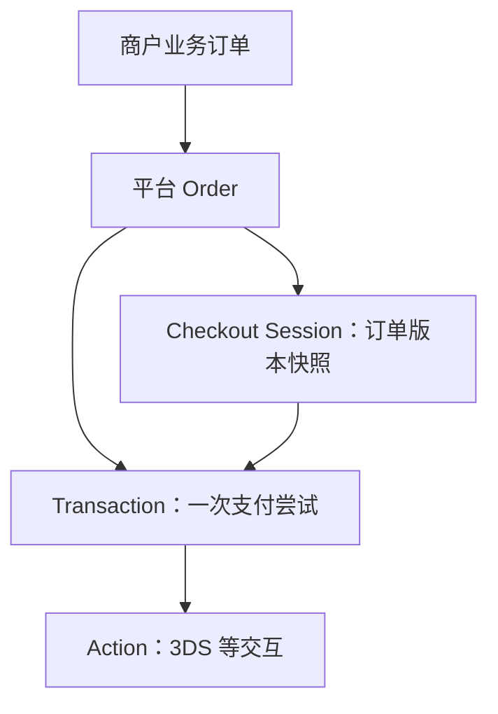
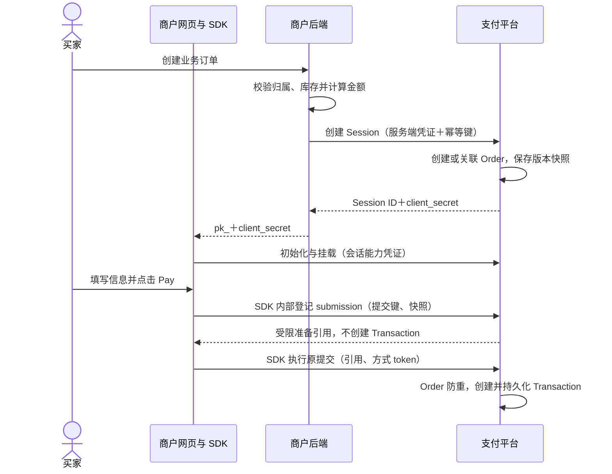
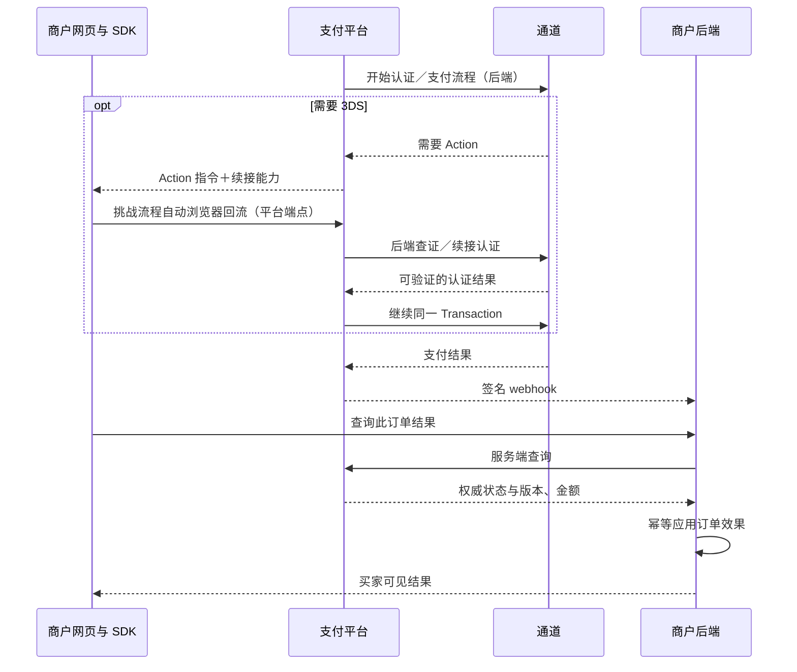
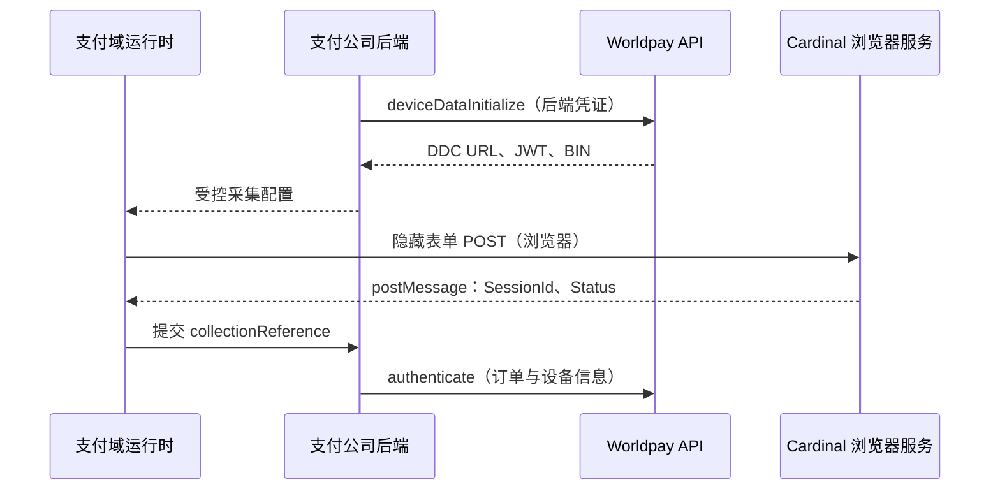
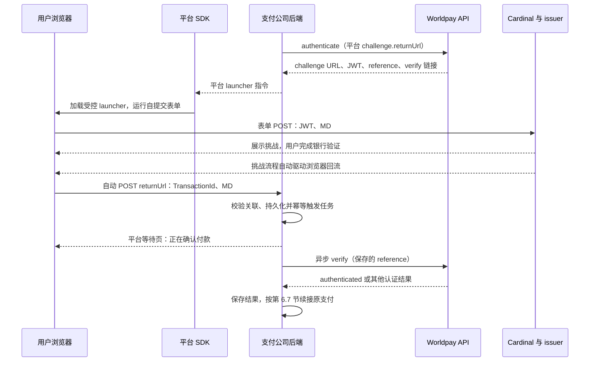
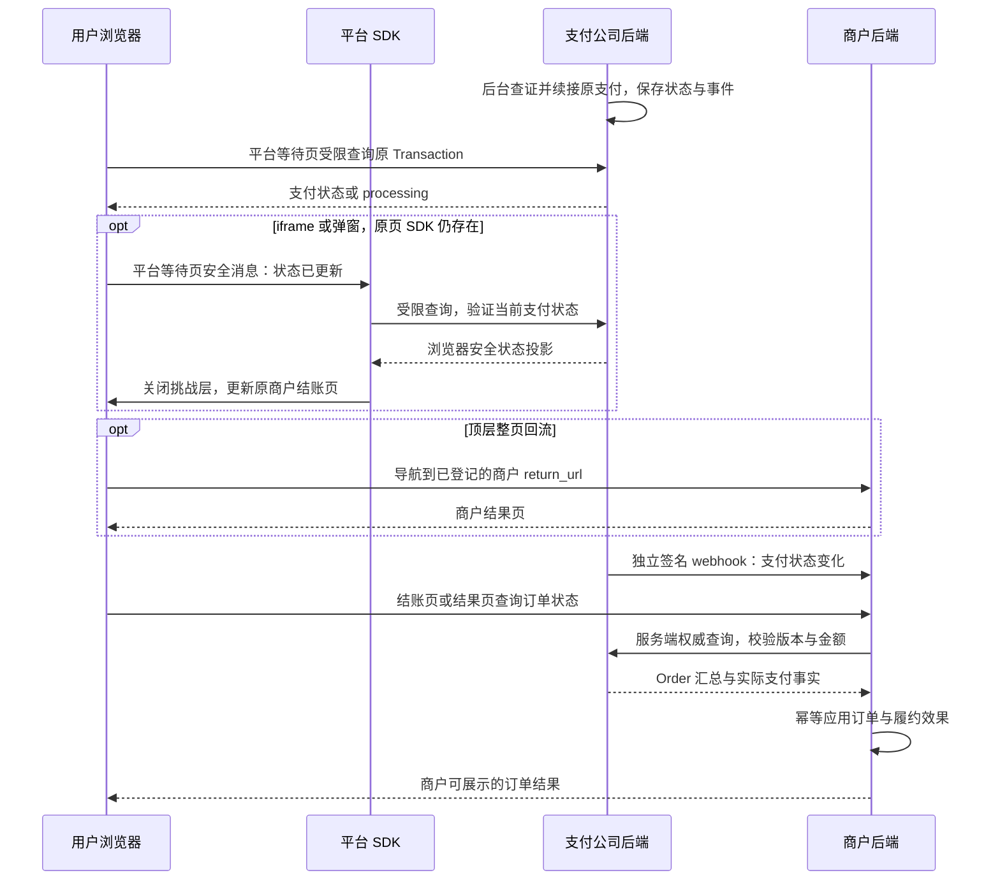
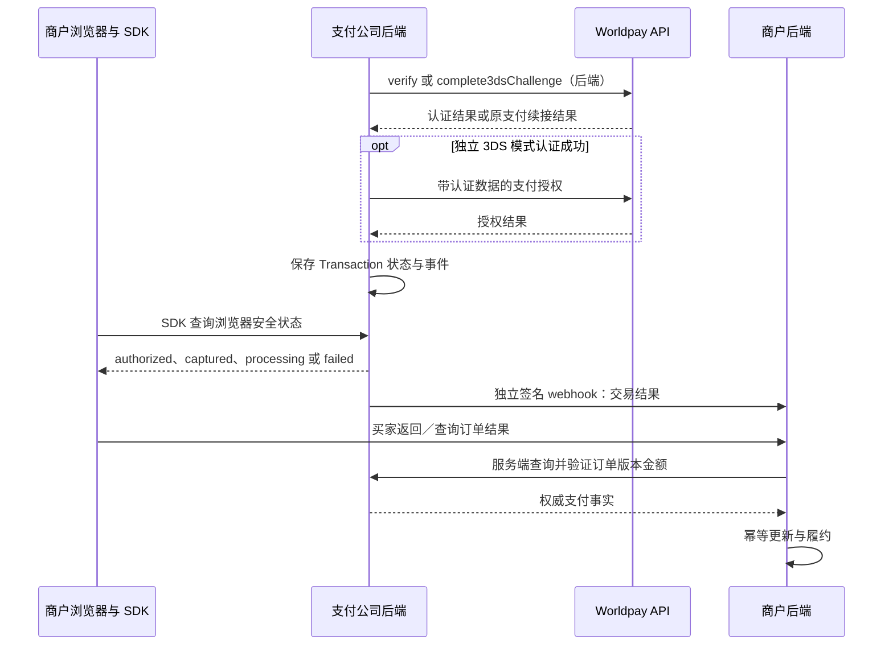

# Payment Element 产品与技术设计说明

面向：产品、后端、前端、SDK、测试与支付通道同事。  
修订日期：2026-10-14。状态：设计稿，接口尚未实施；本文记录已确认的产品决策，并给出拟定契约。接口名称、期限、状态枚举和错误码须在发布前定稿。

## 1. 产品目标与责任分工

本平台通过整页托管或嵌入组件，让商户接受在线支付。商户负责商品、库存、业务订单、买家身份和履约；平台负责支付会话、安全支付信息采集、支付执行、3DS、支付状态与事件通知。

平台同时设计三种接入：Hosted Payment Page（整页托管）、Payment Element（完整支付区域）、Hosted Fields（独立安全字段）。商户的主线是后端创建支付会话 → 打开托管页或挂载组件并确认付款 → 后端提供结果查询 → 后端接收 webhook。创建支付会话时，平台自动创建或关联支付 Order，商户无需先调用独立的创建平台 Order 接口。

| 谁 | 负责什么 | 不应承担什么 |
| --- | --- | --- |
| 商户后端 | 买家鉴权、订单金额、创建会话、权威结果应用、履约 | 浏览器提交的金额不能直接成为支付金额 |
| 商户前端 | 页面、Pay 按钮、提示、向 SDK 提供接入参数 | 不自行采集 PAN/CVC，不决定支付事实 |
| Payment Element SDK | 安全字段、确认请求、3DS 呈现、跳转、续接、有限状态轮询 | 不替商户决定发货，不保管服务端 API 密钥 |
| 平台支付服务 | Order/Session/Transaction、鉴权、幂等、通道编排、回调、对账、webhook | 不依据浏览器声称的成功直接记账 |
| 平台账务服务 | 请款清分、pending、下游结算、available、不可变分录 | 不根据 SDK 事件或 webhook 投递结果移动余额 |

### 1.1 同时提供的三种产品方案

三种方案共用同一套 Order、Session、Transaction、支付编排、3DS、账务和商户结果接口；差别是买家 UI 与字段布局的所有权。本平台的支付页不覆盖完整商城结账：本平台仍不管理商户购物车、库存、配送或业务订单。

| 方案 | Session ui_mode | 商户拿到什么 | 平台拥有的 UI | 商户拥有的 UI |
| --- | --- | --- | --- | --- |
| A. Hosted Payment Page | `hosted` | `checkout_url`，跳转打开 | 支付页、可信订单金额摘要、支付方式、字段、Pay、3DS 与状态提示 | 商城订单、进入支付动作、返回页 |
| B. Payment Element | `embedded` | 一个 Payment Element，挂载到一个容器 | 支付方式区域、字段、校验、方式专属按钮 | 商城结账页、订单摘要、普通 Pay 按钮 |
| C. Hosted Fields | `fields` | 一个 Card Fields 组，挂载到多个字段容器 | 安全字段内部输入、格式化、校验、采集与 3DS | 字段位置、外部标签／错误位置、普通 Pay 按钮及周边表单 |

`embedded` 是嵌入支付区域，不是完整 Embedded Checkout。若未来提供完整结账页 iframe，另建产品契约，不能与本模式混名。

商户可任选三种，B 为文档的默认示例。C 的首期范围为卡支付；它不因为字段可定制就自动提供钱包、银行转账等支付方式。三种都是拟定设计，不表示已经发布三套 SDK。

### 1.2 商户组件数量与内部 iframe 数量

| 方案 | 商户的挂载界面 | 拟定内部实现 | 商户应依赖什么 |
| --- | --- | --- | --- |
| A | 顶层跳转，无商户 iframe | 平台页复用支付采集内核；可有字段、DDC、challenge frame | 托管 URL、返回页、后端结果契约 |
| B | 一个组件／容器 | 一个平台支付区域 iframe；若用 Worldpay 安全字段则内部再嵌套字段 frame | 组件 API、事件、有限 appearance；不依赖内部 frame 个数 |
| C | number、expiry、cvc 多个容器 | 每个安全字段一个跨源 iframe，另有内部协调及必要 Action frame | 字段组 API 和字段状态；不读取 iframe DOM 或自行通信 |

一个大的 Payment Element iframe 与多个小的字段 iframe 可以组合，不能用商户看到一个组件推断底层只有一个 frame。卡字段、隐藏 DDC 和可见 3DS challenge 的职责分别定义，不能让卡号字段框直接接管顶层导航。

使用 Worldpay 采集时优先复用其 Checkout SDK 的 pan／expiry／cvv 配置和安全字段能力；Worldpay 的 card／CVC session 是支付凭证资源，不是本平台 Checkout Session。[U2] 原型的一字段一框只说明演示采集方式，不决定 B 的公开形态。

## 2. 先统一实体：到底创建了什么

### 2.1 四个实体

| 实体 | 含义 | 何时创建 | 关系 |
| --- | --- | --- | --- |
| 商户业务订单 | 商城中的购物订单，由商户保存 | 商户后端确认商品与价格时 | 通过商户订单引用关联平台 Order |
| 平台 Order | 平台内的一笔支付意图 | 首次创建该业务订单的支付会话时 | 一个 Order 可有多个 Session 和 Transaction |
| Checkout Session | 某订单版本的浏览器支付入口与不可变配置快照 | 商户后端调用创建会话接口时 | 属于一个 Order；可先后承载多次 Transaction |
| Transaction | 一次支付尝试；“attempt”只是描述，不是另一实体 | 平台接受一次新的 confirm 时 | 属于一个 Order 和一个 Session；可包含多个 Action |

Action 是 Transaction 的交互子记录，例如一次 3DS 挑战。认证通过后继续同一个 Transaction；它不会创建第二笔支付尝试。



### 2.2 标识与命名

- `merchant_order_reference`：商户生成的稳定业务订单引用。购物车修改保留引用，增加 `order_version`。
- `order_id`：平台 Order ID。
- `checkout_session_id`：平台 Session ID。
- `transaction_id`：一次支付尝试的唯一 ID。
- `action_id`：一个 Transaction 内的交互 ID。

本文统一使用 Transaction、`transaction_id` 和 SDK 的 `transactionId`。原设计的 `attemptId`、`paymentId` 指向同一 Transaction，不能据此创建独立 Attempt 或 Payment 表。为延续原接口规划，`/v1/payments/{transactionId}` 仍作为对外支付资源路径；这是命名别名，内部资源是 Transaction。

### 2.3 平台 Order 的识别与版本

拟定关联键为商户、环境、可选子商户范围和 `merchant_order_reference`。平台从服务端凭证推导前三项，从请求读取订单引用。同一关联键复用同一 Order。

同一订单版本的金额、币种和 capture 策略一经创建会话即不可修改。平台为该快照生成不可猜测的 snapshot ID，SDK 在确认前将其与可见金额关联。呈现模式、到期重建只改变 Session 创建代次；该代次由商户后端持久化并与替换操作原子协调。相同版本但货币快照不同的请求拒绝；改变购物车必须增加版本。较旧版本不得替换较新版本。

新版本 Session 的创建、Order 当前版本的更新、旧 Session 的停止新提交必须原子协调。旧 Session 已提交的 Transaction 继续跟踪。平台保存每个 Transaction 实际支付的订单版本和金额，商户不能把旧版本支付自动当成新版本订单已付。

## 3. 标准流程：从订单创建到结果落定

### 3.1 每一步的输入、凭证与产物

下表和时序图以嵌入方案 B／C 为例。A 同样由商户后端建 Session，但商户浏览器打开托管 URL，挂载和 confirm 由平台页完成。

| 步骤 | 调用方 → 接收方 | 输入来源 | 鉴权 | 产物／效果 |
| --- | --- | --- | --- | --- |
| 1. 创建业务订单 | 买家 → 商户后端 | 商品选择；金额由后端计算 | 商户买家／游客会话 | 商户业务订单 |
| 2. 创建 Session | 商户后端 → 平台管理 API | 权威订单引用、版本、金额、capture 模式、返回地址 | `sk_` 或商户授权的 OAuth token | 创建或关联 Order，创建 Session 与会话凭证；不创建 Transaction |
| 3. 下发参数 | 商户后端 → 买家浏览器 | 已归属校验的 Session | 商户买家／游客会话 | `pk_`、`client_secret`、Session ID |
| 4. 初始化组件 | 浏览器 SDK → 平台浏览器 API | `pk_` + `client_secret` | 会话能力凭证 | 浏览器安全配置、安全字段；不创建 Transaction |
| 5. 确认付款 | SDK → 平台浏览器 API | 会话、方式 token、提交键；金额取服务端快照 | 会话能力凭证 | 认领 Order 支付限制，创建一个 Transaction，持久化后调用通道 |
| 6. 完成交互 | SDK／通道 → 平台 | Action 引用与通道结果 | 浏览器续接凭证／通道回调认证 | 继续同一 Transaction，不另起支付 |
| 7. 应用结果 | 平台 → 商户后端，或商户后端 → 平台 | 签名事件／认证查询 | webhook 签名／`sk_` 或 OAuth | 商户幂等更新业务订单，按政策履约 |

#### 创建入口与受理付款



#### 原交易的认证、支付与结果处理



商户仍只调用一次 confirm；submission 登记与执行是 SDK 内部握手，不增加商户步骤。图中查询与 webhook 可以任意先后发生。浏览器可能被关掉；商户结果应用不能依赖页面存活。

### 3.2 自动与手工请款

`automatic`：平台编排授权和请款，是否合并成一个通道调用由 adapter 决定。成功请款才返回 `captured`。

`manual`：授权成功返回 `authorized`，Transaction 处于 `PAID`，后续商户通过服务端 API 请款或取消。授权成功不代表已经请款。

## 4. 鉴权模型：每种凭证解决什么问题

### 4.1 商户开发者实际需要管理的凭证

| 凭证 | 放在哪里 | 授权范围 | 商户如何接入 |
| --- | --- | --- | --- |
| `pk_test_`／`pk_live_` | 可出现在前端 | 公开商户配置标识，不授权支付 | 交给 `loadWalletPay` |
| `sk_test_`／`sk_live_` | 商户后端 | 已授予的管理 API 操作 | Bearer 请求头；SDK 从服务端配置读取 |
| 商户 OAuth token | 多商户应用后端 | 被连接商户与授权 scope | 替代索取商户无限制私密钥 |
| Session `client_secret` | B／C 对应买家的浏览器内存；A 由平台托管运行时管理 | 单 Session 的 bootstrap、confirm；不能管理资金 | 商户后端下发，交给 `createCheckout` |
| Transaction 续接凭证 | SDK 管理的浏览器内存 | 已存在 Transaction 的有限查询和 Action 完成通知 | SDK 自动获取、使用与清理，商户无需自行续期 |
| webhook 签名密钥 | 商户后端 | 验证该端点收到的事件 | 用原始请求体验签 |

`client_secret` 是敏感 bearer capability，不能称为公开标识或非秘密值；它不是服务端管理密钥，也不是一次用完即失效的“门票”。在有效期内可用于允许的会话操作。

浏览器接入不要求买家登录支付平台，不要求商户实现平台 cookie 登录、token 刷新或 3DS 续接。商户自己的买家／游客鉴权仍然必须存在，用于获取 Session 和查看业务订单。

### 4.2 服务端 API 认证与归属校验

凭证解析出商户、环境、scope、账户状态、开通能力和可选子商户范围。请求体自报的 `merchant_id` 不是权威。每个资源操作都校验归属。

Bearer 秘密包含查找前缀和高熵秘密，存储单向 verifier；只有必须重放原创建响应等需要恢复的材料才使用受控加密存储。支持轮换重叠窗口和吊销。test/live 的密钥与资源隔离。

OAuth token 校验 issuer、audience、有效期、吊销、商户绑定和 scope。内部采用工作负载身份或 mTLS，资源服务重复归属校验。日志仅记录凭证 ID 和脱敏指纹。

### 4.3 Session 能力验证

B／C 的新入口 bootstrap、submission 登记和 confirm 均检查：公钥与能力凭证属于同一商户／环境；Session、订单版本和货币快照绑定有效；操作在授权范围内；未过期且未被替换；商户 origin 精确匹配登记配置。

A 在平台自己的 origin 运行，托管启动引用换取内部会话能力，不使用商户页 pk_／client_secret 引导方式；仍校验商户、环境、订单和操作。

入口能力失效后，不拿它继续 bootstrap；已签发的有效续接能力可读既有 Transaction，能力也丢失时按 §5.3 经商户鉴权恢复。SDK 因过期无法初始化时，商户显示订单结果／重新进入入口，不在浏览器构造新的凭证。

CORS 和 origin 校验是纵深防御，不能代替凭证校验。能力凭证不允许修改金额、创建其他会话、跨商户操作、capture、refund 或读取任意买家数据。

### 4.4 Session 过期后的续接

Session 的有效期决定能否开始新 Transaction。Transaction 的续接能力决定能否完成已存在的交互。两者分别判断。

| Session 已过期／被替换时的操作 | 处理 |
| --- | --- |
| 用旧 Session 创建新 Transaction | 拒绝 |
| 用有效续接凭证通知既有 Action 完成 | 允许；后端另行验证通道证据 |
| 用有效续接凭证查询既有 Transaction | 允许；只返回浏览器安全投影 |
| 用续接凭证发起新授权、改金额、请款或退款 | 拒绝 |
| 接收合法通道结果、对账、投递 webhook | 继续，不依赖浏览器凭证是否有效 |

平台在创建 Transaction 后签发续接能力，绑定 Transaction、Session、商户、环境、允许 origin、有限查询／Action 操作和独立期限。Action 完成权限另校验 action ID、用途和期限，重复通知幂等。

续接凭证过期或页面丢失时，SDK 不能无限续期；前端走商户结果接口，商户后端用管理凭证查询。整页跳转后的结果恢复不依赖把续接凭证放进 URL 或持久化浏览器存储。返回地址只携带不透明 Session 引用。

## 5. 防重复付款：Order 级约束

### 5.1 已确认的规则

**同一 Order 在所有 Session 和订单版本之间，只允许一个未决或已成功授权、尚未确认撤销的 Transaction。已请款的 Order 不接受再次付款。**

这里的限制是持久业务约束，不是浏览器按钮锁，也不是有 TTL 的进程锁。超时、Session 过期、浏览器关闭和创建新版本均不能自动解除。

| 当前支付事实 | 再次 confirm |
| --- | --- |
| 尚无 Transaction | 可创建第一笔 |
| 处理中、3DS 中、结果未知 | 同次请求返回既有 Transaction；其他新支付请求返回进行中，不创建另一笔 |
| 明确拒绝／认证失败，且不存在授权或未知扣款 | Session 仍有效时允许创建新 Transaction |
| UI 被关闭、取消尚未获确认 | 保持未决，不允许新 Transaction |
| 已授权，尚未请款或请款失败 | 不允许另付；先处理原授权 |
| 原授权已经服务端确认取消／失效且无在途请款 | 可重新评估付款资格 |
| 已请款 | Order 已付；不创建另一笔 |
| 请款后 void／退款 | 不自动开放再付；重新收款政策不在本稿范围 |

新版本 Session 可以创建并收集信息，但旧 Transaction 未决时不能提交第二笔付款。迟到成功保存原版本与原金额，商户按履约政策处理，不静默抵扣新版本金额。

### 5.2 三层幂等

| 层次 | 稳定键 | 防止什么 |
| --- | --- | --- |
| 创建 Session | 商户／环境／操作＋商户幂等键 | 网络重放创建重复 Session |
| 确认付款 | Session＋SDK submission key，另加 Order 级约束 | 双击、多标签和跨 Session 平行付款 |
| 通道操作 | Transaction＋具体操作的稳定通道键 | 平台重放造成重复授权／请款 |

平台在外呼前持久化 Transaction、提交键和通道操作键。未知结果优先查询和对账，不盲目换通道。

SDK 在一次逻辑提交的网络重试中复用 submission key；确认原 Transaction 已失败之后的新买家尝试使用新 key。平台不能只依赖 SDK 遵守规则，仍须原子认领 Order 的支付资格。

创建 Session 同键同 payload 在保留窗口内返回原 Session 和原创建响应；同键不同 payload 拒绝。相同版本会话已过期时，创建新会话使用新的持久会话创建代次和幂等键；版本不必仅因过期而增加。代次的存储和并发认领由商户后端完成，不能由浏览器随机决定。

### 5.3 持久提交关联与跨刷新恢复

submission 是平台内部确认操作记录，关联一次逻辑提交，不是新增支付尝试实体。Transaction 仍在真正接受付款时创建。记录至少保存 Session／Order／环境、提交键、payload 指纹、snapshot ID、付款资格代次、prepared／accepted／rejected／revoked 阶段，以及已接受的 transaction_id 和操作结果。

SDK 在用户 confirm 内部先登记 submission，拿到受限提交引用后再发送执行请求。登记只准备操作，不调用通道、不创建 Transaction，也不授权扣款。接受执行时，平台在同一事务中检查准备记录未撤销／过期、快照和资格代次，认领 Order、转 accepted 并持久化 Transaction，然后才外呼。prepared 默认最多有效 2 分钟；接受之后不再依赖该准备期限完成 3DS。

| 原提交情形 | 平台与 SDK 的恢复行为 |
| --- | --- |
| 登记响应丢失 | 同键查询／重放登记，不创建新逻辑提交；bootstrap 可发现本入口待恢复记录 |
| 已登记但未接受执行 | 恢复同一准备记录；或原子撤销并递增资格代次，拒绝迟到的旧执行请求 |
| 已接受但浏览器没拿到 transactionId | 根据 submission 与 Session 查到原 Transaction，查询／续接原操作 |
| 页面刷新，client_secret 或续接能力丢失 | 商户先鉴权买家，再通过管理 API 申请仅续接既有交易的平台恢复入口 |
| 请求结果 unknown | 后台查询／对账并保留 Order 限制，绝不因键或页面期限到期解除 |

恢复 URL 与 Hosted 启动 URL 同样按敏感短期能力处理：只给已鉴权买家，不进日志／埋点，使用 Referrer-Policy: no-referrer；到达平台后一次性交换受限运行时上下文，清理地址栏中的启动引用。该能力不能读取完整买家资料，商户返回地址仍只带 Session 引用。

恢复入口由 `POST /v1/checkout-sessions/{id}/recover` 生成，要求商户服务端凭证、Session 归属与商户端买家鉴权。返回短期 recovery_url，仅能查询／继续已接受的 Transaction 或 Action，不能新 confirm、改金额或管理资金。只有 prepared、尚无 Transaction 时，后端原子撤销准备记录并递增栅栏，返回 recovery_not_required；不会从恢复页发起首笔扣款。恢复期限默认 5 分钟且受 Action 的通道有效期限制；过期重新经商户鉴权申请。返回目标使用 Session 已登记地址。商户页面无需保存或读取原提交键。

同一个实例通过 resume 续接；跨页面通过平台恢复页续接。初始化、刷新或打开恢复页都不能自动创建新付款尝试；需要买家交互时显示明确继续动作。没有可恢复操作时返回 recovery_not_required，商户显示订单结果，不能把它解释为可立即再付。

平台撤销旧入口、替换版本或终结未接受 submission 时，须用持久资格代次／撤销记录拒绝迟到请求。付款资格是平台证据，不能再由商户根据单次 unpaid、旧失败或“已知提交均完成”自行拼装。

### 5.4 幂等、重放与未知结果的具体约束

| 请求情况 | 拟定 v1 行为 |
| --- | --- |
| 同键、同参数且已完成 | 返回原资源关联与已保存响应，不重复执行 |
| 同键、同参数且执行中 | 返回 409 request_in_progress 与 Retry-After，SDK 等待／查询原操作 |
| 同键但参数改变 | 返回 409 idempotency_conflict；包括金额、快照或方式凭证指纹改变 |
| 参数无效且执行未开始 | 返回 invalid_input／configuration_error，不调用通道；可修正后建立新的逻辑提交 |
| 5xx 或连接断开，可能已经执行 | 视为未知，原键查证；不能凭 HTTP 状态断言失败或换键重授权 |
| 完整响应重放窗口结束 | 返回原资源引用与 replay_expired，改走授权查询；旧键不能重新创建付款 |

拟定完整创建响应重放窗口至少 48 小时，且不早于该 Session 到期；创建响应中的秘密按受控加密与原权限重放。响应窗口与操作身份保留分离：Order／Transaction 存续期间保存原键指纹、资源关联及撤销栅栏；归档后仍可查证旧键，不能把清理响应缓存等同允许再次扣款。失效秘密不会因重放变成有效，跨刷新用恢复入口。

定期任务按通道规则查证 unknown，记录最后证据时间和下一次核对时间。超过配置的运营时限升级人工核查；人工也必须凭通道证据或确定未受理的栅栏解除限制，不提供“强制标失败后重扣”的默认按钮。通道查证与人工关闭均审计。


## 6. 3DS 信息流：以 Access Worldpay Web 接口为例

### 6.1 结论与适用范围

**这是前后端混合流程：浏览器承担设备采集、挑战表单提交和买家交互；支付公司后端承担认证 API、结果查证、支付授权和商户事件通知。**

本章将“官方接口事实”与“本平台拟定实现”分开。核查日期为 2026-10-14，基线是 Worldpay 独立 3DS API v3 Web；同时说明其 Payments API Integrated 3DS 路径。本文中的“支付公司”指我们的平台，不是接入我们 SDK 的外部商户。

不能将两种接入混合：独立模式的 `3ds:verify` 是认证查证，随后还须支付授权；Integrated 模式的 `complete3dsChallenge` 续接 Worldpay 原支付流程。两种模式均保持本平台同一个 Transaction。[W4][W5]

### 6.2 四种 URL 与三种不同的“完成”

| 名称 | 谁提供／谁持有 | 用在哪里 | 含义 |
| --- | --- | --- | --- |
| `challenge.url` | Worldpay 后端响应，支付公司后端保存 | 浏览器受控页面的表单 POST action | 启动挑战；可能是 Cardinal StepUp 入口，不等于直接 ACS URL |
| 平台 challenge launcher URL | 支付公司生成 | SDK 的 iframe src | 加载支付公司托管的自提交表单页面；是我们的实现选择 |
| Worldpay `challenge.returnUrl` | 支付公司在认证／支付请求中设置 | 挑战完成后的浏览器 POST | 接收挑战完成通知的支付公司后端地址 |
| 商户 Session `return_url` | 商户后端创建 Session 时设置 | 整页支付交互结束后的商户回流 | 买家返回商城查看订单；不是 Worldpay challenge return endpoint |

Worldpay Web 文档要求通过表单 POST 提交 `JWT` 到 `challenge.url`。完成挑战后，回流表单携带 `TransactionId`，以及可选 `MD`；前者对应 `challenge.reference`。官方示例中的 challenge URL 可为 Cardinal 的 `/V2/Cruise/StepUp`。[W1][W6]

| 信号 | 出现在什么位置 | 是否足以宣布付款成功 |
| --- | --- | --- |
| 浏览器挑战完成／return POST／`actionend` | 浏览器交互和平台回流入口 | 否；只是触发查证 |
| Worldpay `authenticated` | 后端认证或 verification 响应 | 否；证明认证结果，之后授权仍可能拒绝 |
| 授权／请款成功 | 后端支付响应、认证回调或查询证据 | 才能分别建立 authorized／captured 支付事实 |

平台的回流处理页可以在 iframe 内显示“验证完成，正在确认支付”，但不能因收到 POST 就显示“付款成功”。

### 6.3 阶段一：设备数据采集 DDC

官方接口事实：支付公司调用 `3ds:deviceDataInitialize`，得到 DDC URL、JWT 和 BIN。浏览器隐藏 iframe 内的表单提交后，Cardinal 用 `postMessage` 返回 `SessionId` 和 `Status`；成功时将 `SessionId` 作为后续认证的 `deviceData.collectionReference`。DDC 失败可按文档重试或不带该引用继续，并补充浏览器数据。[W2]

本平台拟定实现：

1. 支付域控制支付凭证和 BIN；不把 PAN/CVC 或 DDC JWT 交给商户业务代码。
2. 后端初始化 DDC，支付域内的运行时加载隐藏表单，浏览器实际完成采集。
3. 受控运行时验证 Cardinal 的 origin、预期窗口和消息结构，将引用提交给平台后端。
4. 平台后端组合订单快照、浏览器数据和 collectionReference，调用 authenticate。



DDC 可在买家确认前预热，也可在 confirm 后编排。若预热，使用独立的 3DS 上下文，并在 Transaction 接受时绑定；不能仅因采集初始化创建一个支付 Transaction。Worldpay 同一次 DDC、authenticate 和 verify 的 `transactionReference` 必须保持一致；它可映射平台 3DS 上下文，不等于其返回的 `authentication.transactionId`。[W3][W4]

### 6.4 阶段二：后端认证与 Action 创建

独立模式由平台后端调用 `3ds:authenticate`。Frictionless 情况直接获得认证结果，无需可见挑战。需要挑战时，adapter 保存 `challenge.reference`、URL、JWT 和 `3ds:verify` 链接，生成本平台 Action。[W1][W3]

拟定 Action 子记录包含：本平台 Transaction ID、Action ID、Worldpay 账户／环境、3DS 上下文引用、challenge reference、加密的 JWT、验证／续接链接、返回关联 state、上游有效期和本平台处理阶段。它是 Transaction 子记录，不另建 Attempt。

SDK 父侧仅收到我们的呈现指令，例如：

```json
{
  "kind": "action",
  "transactionId": "txn_example",
  "action": {
    "id": "act_example",
    "type": "three_ds_challenge",
    "presentation": "embedded",
    "launcherUrl": "https://payments.walletpay.example/3ds/launch/opaque_reference"
  }
}
```

这是我们拟定的协议，不是 Worldpay 原响应。launcher 引用可用于启动挑战，同样按短期敏感引用处理，不含原始 JWT、卡数据、认证值或服务端凭证。页面不得缓存，日志脱敏，设置受限 frame-ancestors 和 Referrer-Policy。单一用途代表只能启动绑定的 Action；网络重放须安全幂等，不能因一次 GET 已消费而让加载失败无法恢复。

挑战 URL 和 JWT 在支付域 launcher 页面内仍会进入浏览器，才能提交给 Cardinal；“不交给商户代码”并不意味着“绝不进入前端”。商户主页面不能跨源读 launcher DOM，但它可以看到我们下发的 Action 标识和 launcher 地址。不要把地址可见误当成包含原始挑战数据。

### 6.5 阶段三：challenge URL 如何到达浏览器

Worldpay API → 支付公司后端 → 支付域 launcher 页面 → 买家浏览器 POST → Cardinal／issuer 挑战页面。

SDK 将 iframe 的 `src` 设置为我们托管的 launcher，而不是 `challenge.url`。launcher 从后端读取已保存的 Action，服务端安全转义渲染如下形式的表单，再由浏览器提交：

```html
<!-- 支付域内的平台页面；示意值由后端取自保存的 Action。 -->
<form id="challenge-form" method="POST" action="https://trusted-stepup.example/StepUp">
  <input type="hidden" name="JWT" value="ESCAPED_PROVIDER_JWT">
  <input type="hidden" name="MD" value="OPAQUE_ACTION_STATE">
</form>
<script nonce="SERVER_GENERATED_NONCE">
  document.getElementById("challenge-form").submit();
</script>
```

这里的 HTML 是我们的示意实现，POST 字段名和用途依据 Worldpay。`MD` 只携带不透明关联值，不存订单明细、身份、secret 或认证结果。URL 必须来自已验证的 adapter 配置和响应，不能接受商户任意提供的跳转目标。[W1]

不能用服务端 HTTP 请求代替这次浏览器提交：issuer 要在买家浏览器中呈现并完成挑战。也不能假设把 URL 设为 iframe src 的 GET 与该 POST 等价。

### 6.6 阶段四：挑战完成如何到达支付公司

**在我们的架构里，`challenge.returnUrl` 必须指向支付公司控制的后端入口。挑战完成后的 POST 由 Worldpay／issuer 挑战流程自动驱动，在买家浏览器中发生，不是后台 webhook。** 支付公司 SDK 无需在挑战结束后自行模拟这次 POST，外部商户也无需编写它。[W1]

“自动”有明确的前提：支付公司后端已经在 Worldpay 认证／支付请求中设置正确的 `challenge.returnUrl`，SDK／托管页面已经按协议启动挑战，且浏览器正常完成挑战并执行回流。它不表示即使浏览器提前关闭也一定能收到通知。

| 动作 | 谁实现／谁驱动 | 在前端还是后端 | 外部商户是否需要实现 |
| --- | --- | --- | --- |
| 设置 `challenge.returnUrl` | 支付公司 adapter 在 Worldpay 请求中设置 | 支付公司后端 | 不需要 |
| 创建 iframe、提交启动挑战的 JWT 表单 | 支付公司 SDK／支付域托管页面实现 | 买家浏览器 | 不需要 |
| 挑战结束后 POST 到该 URL | Worldpay／issuer 挑战流程自动驱动浏览器 | 浏览器 → 支付公司后端 | 不需要；SDK 也不自行伪造该回流 |
| 接收 `TransactionId`／`MD` 并查证 | 支付公司后端校验关联，再调用 verify／通道续接 | 支付公司后端 → Worldpay 后端 | 不需要 |
| 通知 SDK 恢复界面 | 支付公司提供的回流 HTML／协调页面脚本 | 支付域页面 → SDK，随后查询后端 | 不需要专属 3DS 代码 |
| 接收规范化支付结果并更新业务订单 | 支付公司发 webhook，商户后端接收或主动查询 | 后端 → 后端 | 需要；这是标准支付接入 |

Worldpay 文档中的“your backend”指直接接入它的系统。本架构中直接接入方是支付公司，不能把这一表述解释成外部商户必须接收 Worldpay challenge return。商户若绕过本平台直接接入 Worldpay，才由商户自己承担该职责。

本平台将该地址设为自己控制的支付域后端，例如 `https://payments.walletpay.example/3ds/returns/OPAQUE_ACTION_STATE`，不直接填写外部商户的 Session `return_url`。

#### 平台回流处理与等待页

**`challenge.returnUrl` 可以同时作为平台后端 POST 处理入口和平台中转等待页入口，这是本平台采用的设计。** 它不是纯静态前端页面：后端先校验并持久化回流关联，幂等触发查证任务，再向浏览器返回平台 HTML，显示“验证已返回，正在确认付款”。Worldpay 明确允许接收端后端发起 verification，并在 iframe 中显示页面；等待页、异步任务和商户回流策略由本平台实现。[W1]

拟定处理顺序如下：

1. 后端接收并校验 POST，将信号关联到原 Action／Transaction，持久化后幂等触发查证。重复 POST 或刷新不得产生新的授权／请款。
2. 返回平台等待页。可在保存关联后用 `303 See Other` 转到平台受控 GET 等待地址，避免刷新重放 POST；地址只带不透明引用，不带 secret、认证值或可信成功标志。
3. 后端异步执行 verify 或 Integrated 续接，持久化结果；独立模式认证通过后继续原 Transaction 的授权与按策略请款。任务须可重试与崩溃恢复，不能只依赖 HTTP 应答后的进程内函数。
4. 等待页／SDK 通过受限的浏览器状态接口查询同一个 Transaction。单凭等待 URL、Session ID 或浏览器提交的 outcome 不能读取任意交易；访问能力绑定 Action／实例和有效期，具体恢复机制发布前定稿。
5. 等到可展示的支付结果后，由平台结束挑战呈现或导航到商户结果页。等待超过界面阈值时可展示 processing 并返回商户“处理中”页；阈值不改变支付事实，也不自动开放再次付款。

平台后端查证不依赖等待页持续轮询。回流已经持久化后，即使页面关闭，后台仍按任务与通道事实处理；若浏览器在回流前关闭，则不能承诺已进入这一阶段。

以下两图分别展示挑战回流和商户结果流转，明确列出用户浏览器与商户后端。SDK 是用户浏览器中的平台代码，以独立逻辑泳道表示，不是另一台服务器；浏览器泳道表示页面、frame 和实际 HTTP 导航。商户后端接收平台支付事件，不接收 Worldpay challenge return。

**图一：挑战启动、用户浏览器自动回流与后端查证。** 本图以独立 3DS 模式为例；Integrated 模式的后端续接见第 6.7 节。



**图二：平台等待页、SDK 与商户后端如何获取结果。** 承接图一的持久化任务；查询、事件投递和页面回流可能交错，以下只画一种发生顺序。



图二的受限等待页查询可由页面自身或支付域协调运行时执行。整页跳转后原商户 SDK 可能已经销毁，因此不把 SDK 消息作为顶层回流的前提；用户浏览器返回商户时，也不携带用于决定履约的可信成功标志。

浏览器 POST 不携带我们的 `sk_` 或 Worldpay BasicAuth，不要求外部商户买家 cookie、旧 Session client_secret 或续接凭证仍有效。它不是普通会话 API：用预先持久化的不透明 state、Action、通道账户／环境和 provider reference 做关联，再用后端 API 查证。返回的 `TransactionId`／`MD` 都是待校验输入，不能据此直接写成功或替换本地记录。

平台回流等待页／支付域协调页面可发送安全 `postMessage`，例如 `three_ds.return_received`、Action ID 和实例 ID；SDK 校验 origin/source/schema 后触发有限状态查询。该提示可在 verify 完成前发出，但只表示回流已收到，不意味着立即关闭等待界面或跳转成功页。用于完成呈现的后续消息同样只提示 SDK 查询后端；浏览器的 `outcome` 不能决定服务端事实。这段脚本由支付公司实现，不是 Worldpay 原生的成功支付通知。

#### 等待结束后的呈现与商户回流

| 当前浏览器上下文 | 平台如何结束等待 | 商户接入体验 |
| --- | --- | --- |
| 顶层托管页／整页挑战 | 平台控制顶层上下文时，导航到创建 Session 时已校验登记的商户 `return_url` | 商户结果页调用自己的后端确认订单；URL 不传可信成功状态 |
| 商户页中的 challenge iframe | 等待页通知平台 SDK，SDK 查证后关闭挑战层并更新原支付区域；若需整页跳转，由父页 SDK 按导航契约执行 | 通常留在商户结账页，不强制跳回结果页 |
| 独立弹窗 | 通知 opener 中的 SDK，确认后关闭弹窗并更新原页；opener 丢失时显示状态与返回商户的安全操作 | 弹窗受浏览器手势与跨窗口限制约束，不能假设始终可关闭或控制父页 |

iframe 内直接重定向到商户地址，只会在 iframe 内加载商户结果页，不会自动改变顶层页面。不能让挑战 frame 无条件导航顶层。导航目标从服务端保存的已校验配置读取，不能接受回流 POST 或 URL 中任意提供的跳转地址。

只有后端确认的授权／请款事实才能显示相应结果。verify 成功时如授权仍在进行，等待页继续显示“正在确认付款”；认证或支付明确失败时显示失败结果；未决时显示 processing。平台可在这些情况下返回商户结果页，但不能把任何一次返回本身当成付款成功。

原 `/actions/{actionId}/complete` 只保留为 UI 提示和兜底触发入口，不能成为服务器知道挑战完成的唯一途径。正式实现以回流已经持久化、后端查证与通道支付结果为准。

challenge frame 需要测试后的表单提交和回流权限；不能直接照搬卡字段 iframe 禁止表单的 sandbox。优先将挑战放在独立支付域协调 frame 中，区分父页—平台协议和平台—Cardinal 协议。内层跨域 provider 消息由受控适配层处理，不能要求 issuer ACS 实现我们的字段协议。

### 6.7 阶段五：查证结果后，谁发起支付

| 接入模式 | 浏览器完成后由平台后端调用 | 后端获得什么 | 下一步 |
| --- | --- | --- | --- |
| 独立 3DS API v3 | 响应的 `3ds:verify` 链接 | 认证 outcome，以及成功时的 version、ECI、authenticationValue、authentication transaction ID | 平台后端把认证数据放入 Card Payments 授权请求 |
| Payments Integrated 3DS | 响应的 `complete3dsChallenge` action，无请求体 | 原支付流程续接后的 payment outcome 与 3DS 摘要 | 根据授权结果处理 capture；不另建支付尝试 |

独立模式的 verification 请求示意如下，使用服务器保存的字段，不复制浏览器自报值：

```json
{
  "transactionReference": "three_ds_context_example",
  "merchant": { "entity": "configured_entity" },
  "challenge": { "reference": "saved_provider_reference" }
}
```

verify 使用 Worldpay 后端认证和 v3 媒体类型。认证数据只留在平台受控后端并传给授权 adapter；不能从浏览器读一个“authenticated”消息就开始扣款。authenticationValue 不能用于多个授权请求；不确定的授权结果须先查证，不能用同一认证值盲目新授权。[W4][W7]

独立模式通常是 DDC → authenticate／challenge／verify → authorize，不能统一画成“先向发卡行请求授权，银行才要求 3DS”。Integrated 模式先调用支付入口，Worldpay 在内部安排认证和后续授权。soft decline 后补认证按 §6.11 的显式通道能力与操作键执行，不默认适用于所有 adapter。[W3][W5]

### 6.8 阶段六：认证和支付结果如何到商户

平台后端持久化认证结果，调用／续接支付，取得授权或请款结果；状态与待投递事件同事务提交。然后分别更新前端显示与外部商户后端。



商户后端接收的是本平台规范化支付结果，不是 Worldpay challenge JWT、CAVV/AAV、完整原始响应或 iframe 表单。前端 `actionend` 只协调界面；商户发货依据后台支付事实。

若产品需要展示“已完成银行验证”，可在受认证服务端查询／事件中新增可选 3DS 摘要，区分认证状态与支付状态。该摘要是待定的扩展，不要求商户将原始认证值用于发货。

### 6.9 Integrated 3DS 的 Action 映射与标识

Integrated 模式中，Worldpay 的 `3dsDeviceDataRequired` 返回 `supply3dsDeviceData` action；采集完成后由平台后端提交 collectionReference。`3dsChallenged` 返回 `complete3dsChallenge` action；挑战后仍由平台后端调用它。Worldpay `_actions` 是通道后端续接链接，平台 SDK Action 是浏览器呈现指令，两者不能直接等同。[W5][W6]

| Worldpay 字段 | 本平台含义 | 避免的混淆 |
| --- | --- | --- |
| `transactionReference` | 保存的 3DS 上下文引用，同三类独立 API 请求 | 不随 verify 换新引用 |
| DDC `SessionId` | collectionReference | 不是 Checkout Session ID |
| `challenge.reference` | providerChallengeReference | 不是平台 Transaction ID |
| 回流表单 `TransactionId` | 与保存的 challenge reference 匹配 | 不能覆盖平台 `transaction_id` |
| `authentication.transactionId` | providerAuthenticationTransactionId | 是认证标识，不是付款尝试 ID |
| `acsTransactionId` | providerAcsTransactionId | 按需保存，与其他 ID 分开 |
| `_links`／`_actions` | adapter 保存的通道续接能力 | 不暴露给商户作为管理 API |

### 6.10 丢页、超时与期限

1. 回流已被平台后端持久化后，即使父页面关闭，后端仍能安排查证和支付续接。
2. 浏览器在 return POST 前消失，不能假设 Worldpay 独立 3DS 自动向我们发送认证结果 webhook。核查页面给出的路径是浏览器回流＋后端 verify；未提供独立认证 webhook 的保证。[W1][W4]
3. 超时恢复须依据对应 API 的已验证查证、状态查询和到期语义；不能在挑战仍进行中提前调用 Integrated complete3dsChallenge，它可能导致失败。[W5]
4. 验证／续接外呼未知时保持未决，禁止新付款；不能把本平台通用重试规则当作 Worldpay 每个 endpoint 已承诺幂等。
5. 官方 Web 文档说明 challenge JWT 有 10 分钟期限。本平台续接凭证有效不代表上游 JWT 可延期；Session、续接能力、上游 JWT 和 Action 截止时间分别管理。[W1][W6]
6. 支付采集凭证也有独立有效期；adapter 必须在上游期限内完成 token 化和支付引用使用，不能由我们的 Session／续接凭证延长其期限。
7. 回流 POST、SDK 提示与恢复 worker 并发时，原子认领同一 Action 处理步骤；verify／authorization 各保存操作状态，避免并行外呼。

发布前需与 Worldpay 确认“浏览器 return 丢失后如何查证”、verify／complete 的重复调用语义及原交易查询能力。未经确认，不能承诺“任何时候关页都能继续成功扣款”。

### 6.11 3DS 决策与失败恢复政策

SDK 的职责是呈现，是否请求／要求认证由平台风控政策和通道规则决定。商户服务端可请求 authentication_preference=automatic／prefer_frictionless／prefer_challenge；这是偏好，不能保证 issuer 采用相同形式，也不存在可绕过强制认证的 off 选项。首期可仅开放 automatic，其余偏好通过能力开关控制。

| 通道事实 | 平台决策与执行 |
| --- | --- |
| 无需认证／frictionless 成功 | 按通道规则继续同一 Transaction 的授权 |
| 需要 challenge | 创建 Action，SDK 按受支持导航路径呈现，认证后后端查证再续接 |
| 明确认证失败 | 原尝试 failed；平台确认无有效授权／未知扣款后才可允许新尝试 |
| 认证不支持或不可用 | 由强制认证、风险与 adapter 规则决定允许非 3DS 授权还是拒绝；不统一降级为通过 |
| 授权返回允许补认证的 soft decline | 先确认原授权未成功，再在同一 Transaction 新建认证 Action，最多一次补认证后续接；未知授权先查证，不平行重发 |
| 用户取消／回流缺失／等待超时 | Action 记录呈现结果，交易进入 processing／requires_action／unknown 的实际阶段；不能只凭关窗设置 failed |

每次后端认证／授权调用都有独立稳定操作键和证据。已有 authenticationValue 不盲目重复用于新的授权；soft decline 路径由 adapter 显式支持，不能复用未知成功的原调用。通道不支持安全补认证时返回可解释结果，不擅自切账户／通道重新扣款。

管理查询提供经过规范化的 authentication 摘要：状态、协议版本、挑战是否发生、失败分类和必要的责任转移证据引用；原始认证值仍不交给商户。认证成功不直接承诺争议责任一定转移，责任判断按交易与通道证据处理。本节策略需风险负责人和通道验收后开通，发布时列入支持矩阵。


## 7. 状态与账务边界

### 7.1 入口、执行状态与账务状态

Session 表达入口是否可接受新尝试，Transaction 表达单次支付执行，Order 汇总同一支付意图。三者分别建模。账务状态继续使用现行 PAYING → PAID → CAPTURED → SETTLED；PAID 只表示已授权。以下 execution_status 是同一 Transaction 的持久执行投影，不增加 Payment／Attempt 实体，也不替代 ADR 的资金分录规则。

| execution_status | 建立该事实的条件 | 后续允许的支付行为 |
| --- | --- | --- |
| processing | 已受理，后台操作尚在进行 | 查询或续接原操作，不另付 |
| requires_action | 通道要求仍有效的买家交互 | SDK 继续原 Action，不创建新尝试 |
| unknown | 已可能外呼，但缺少确定结果 | 查询／对账原操作，维持 Order 限制 |
| failed | 认证／付款明确失败，且没有授权、未决外呼或在途请款 | 平台重新评估 Order，当前入口有效才允许新尝试 |
| authorized | 后端确认授权有效，未确认请款成功 | 对原授权请款／取消；请款失败也不另付 |
| captured | 后端确认请款成功 | 按现行账务规则处理 void／结算／退款，Order 不再收款 |
| canceled | 后端确认原尝试未形成有效授权，或授权已撤销／失效，且无在途请款 | 平台评估是否可新尝试；不因 UI 取消直接设置 |

处理中可转 requires_action／unknown／failed／authorized／captured；Action 可重新进入 processing，unknown 仅凭通道事实或可证明未受理的操作栅栏消解。尚未形成授权时，账务主状态可仍为 PAYING；必须结合 execution_status 判断它是否未决，不能仅凭 PAYING 永久阻止确定失败后的新尝试。该组合需在 ADR 审核中明确记录。failed／canceled 的交易不重新授权；新买家尝试创建新 Transaction。authorized 的请款操作 processing／unknown／failed 不把授权降为 failed；只有撤销／失效确认后才转 canceled。

取消、void、退款、结算属于各自操作或账务事实。请款后的 void／退款不把 captured 的原支付历史改写成“未发生”，不自动开放 Order 再付。SETTLED、部分退款等后续账务演进仍按 ADR；execution_status 可保持 captured。所有状态转换校验原交易与操作修订，不按回调到达顺序覆盖。

Order.payment_status 是 unpaid／processing／authorized／captured／failed 的汇总；requires_action 和 unknown 对普通商户结果页归 processing，详情可用于 SDK 交互。旧版本有效授权或请款保留其实际版本金额，不能自动满足新版本。Session 状态独立为 open／expired／replaced／completed。

### 7.2 操作资格与资金边界

平台返回 allowed_operations 和原因，不让商户推断通道执行资格。新 confirm 的资格取决于当前 Session、快照、Order 原子限制与未决提交栅栏；管理 API 仍校验 scope 和商户归属。商户只能按自己的业务政策进一步收紧操作。

| 操作 | 必须满足的已确认事实 | 返回的主要资格信息 |
| --- | --- | --- |
| confirm | 当前入口和快照有效，Order 无在途／有效授权／已请款限制 | allowed、reason、eligibility_revision |
| capture | 原授权有效，无未决请款／取消；金额在可请款范围 | capturable_amount、capture_before、allowed、reason |
| cancel | 原授权可撤销，或执行操作能安全终止；需通道确认才释放限制 | pending／succeeded／failed／unknown |
| void | 当前通道和账务阶段允许撤销请款 | allowed、reason；不能当作取消 Session |
| refund | 满足当前 ADR 的下游已结算闸门，累计不超过可退款金额 | refundable_amount、allowed、reason |

未能确认 capture_before 时不得猜测统一天数；adapter 按通道规则返回明确期限或 reason=authorization_expiry_unverified 并阻止新的手工请款。授权到期由后台查证，不能只用浏览器时钟解除 Order 限制。部分请款是否支持按首期通道矩阵声明；不支持时拒绝，不能静默变为全额。

退款闸门保持不变：未结算时返回 not_settled，并在允许时提示 cancel／void；没有可行替代操作则说明等待／人工处理。退款、请款与取消都有独立操作 ID、幂等键和 pending／succeeded／failed／unknown 结果；操作未决时不得再创建同类平行资金操作。

- 请款成功清分一次，净额进 pending；下游结算才转 available。
- 上游通道到账、3DS 完成和 webhook 投递不直接改变资金可用性。
- 下游结算、费用、保证金、部分退款、void 等分录继续由现行 ADR 控制。

## 8. 公共接口与 SDK 接入契约

阅读顺序：选呈现方式 → 服务端创建会话 → 按方案接入 → 处理结果与恢复 → 管理生命周期 → 查接口清单。三种方案共享支付内核和 Order 级防重；所有接口、包名和新增恢复字段仍是拟定契约。当前草案版本为 2026-10-14.preview，具体 HTTP header 与 SDK 配置由同版 OpenAPI 固定。

### 8.1 选择接入方式

| 方案 | ui_mode | 商户前端得到什么 | 商户需要调用 confirm 吗 |
| --- | --- | --- | --- |
| A. Hosted Payment Page | hosted | checkoutUrl，顶层跳转 | 不需要，平台页调用 |
| B. Payment Element | embedded | 公钥和 clientSecret，单个支付组件 | 需要 |
| C. Hosted Fields | fields | 公钥和 clientSecret，统一多字段组 | 需要 |

§8.3–§8.5 分别给出三种方案的 JavaScript／React 示例。它们引用 §8.6 的共享商户模块；先看方案，再按需要展开共享实现。业务订单接口、CSRF token 和重建页面回调由商户实现，不能把示例辅助函数误认为 SDK API。

### 8.2 创建 Session：服务端公共契约

三种方案使用同一个创建接口，通过 `ui_mode` 选择呈现方式；省略时默认为 `embedded`。它在 Session 创建后不可变。金额、版本、防重和结果语义保持一致。

```http
POST /v1/checkout-sessions
Authorization: Bearer sk_test_...
Idempotency-Key: checkout_ORDER-100123_v1_g1
Content-Type: application/json
```

```json
{
  "merchant_order_reference": "ORDER-100123",
  "order_version": 1,
  "ui_mode": "embedded",
  "amount": { "value": 1099, "currency": "USD" },
  "capture_mode": "automatic",
  "return_url": "https://shop.example/payments/return",
  "locale": "zh-CN",
  "navigation_policy": "allow_redirect",
  "expires_in_seconds": 1800
}
```

```json
{
  "id": "cs_example",
  "order_id": "ord_example",
  "ui_mode": "embedded",
  "client_secret": "cs_example_secret_example",
  "expires_at": "2026-10-14T00:00:00Z",
  "session_status": "open",
  "transaction_id": null
}
```

金额使用货币最小单位。返回 URL 按商户登记配置校验；不接受每会话指定的任意 webhook 地址。创建接口原响应可幂等重放，普通查询不返回 secret。创建响应中的 `order_id` 表示已自动关联平台 Order。

`hosted` 响应只包含托管启动 URL；`embedded`／`fields` 响应包含会话能力凭证，不包含托管 URL。公共查询返回归属与状态，不重发这些能力。

```ts
type SessionBase = {
  id: string; order_id: string; expires_at: string;
  session_status: "open" | "expired" | "replaced" | "completed";
};
type CreateSessionResponse =
  | (SessionBase & { ui_mode: "hosted"; checkout_url: string })
  | (SessionBase & { ui_mode: "embedded" | "fields"; client_secret: string });
```

`transaction_id` 仅关联本 Session 的某次尝试。管理查询返回 `order_payment` 汇总同 Order 的在途／授权／请款交易（包括其他 Session），并返回平台计算的入口资格。商户后端校验版本金额并应用业务政策，不重建支付恢复算法。

```ts
type OrderPaymentSummary = {
  payment_status: "unpaid" | "processing" | "authorized" | "captured" | "failed";
  transaction_id?: string;
  execution_status?: "processing" | "requires_action" | "unknown" | "failed"
    | "authorized" | "captured" | "canceled";
  order_version?: number;
  amount?: { value: number; currency: string };
  capture?: "manual" | "pending" | "failed";
  revision: number;
};
type OperationEligibility = { allowed: boolean; reason?: string };
type SessionPaymentEligibility = {
  confirm: OperationEligibility;
  resume: OperationEligibility;
  replace_session: OperationEligibility;
  revision: number;
};
```

查询同时返回 snapshot（id、amount、order_version）和 payment_eligibility。提交资格只由平台计算，字段完整性另由 SDK 合并。资格修订只提供一致性线索，每次执行仍重新校验；普通资源查询不返回 secret、submission 执行令牌或可恢复 URL。

授权／请款／退款管理查询另外返回 allowed_operations、capture_before、capturable_amount 与 refundable_amount；原因码和金额边界按 §7.2。旧版本成功仍保留实际版本与金额。

### 8.3 方案 A：Hosted Payment Page

商户后端创建 `ui_mode: "hosted"` 会话。响应返回 Session ID、Order ID、过期时间与 `checkout_url`，不向商户浏览器提供本模式的 `client_secret`；商户前端无需 pk_ 或支付 SDK。

```json
{
  "id": "cs_hosted_example",
  "order_id": "ord_example",
  "ui_mode": "hosted",
  "checkout_url": "https://payments.walletpay.example/checkout/opaque_launch_reference",
  "expires_at": "2026-10-14T03:00:00Z",
  "session_status": "open",
  "transaction_id": null
}
```

这是含短期启动能力的受控 URL，应只返回给有权支付该订单的买家。不能在 URL 中附加 `client_secret`、卡数据或可信支付状态。启动引用按敏感值脱敏、不进埋点，加载后用受控方式建立平台页上下文；普通管理查询不重发该能力，创建幂等重放在保留窗口内可返回原响应。

平台页负责展示服务端金额、方式、字段与 Pay，使用同一支付内核确认。平台内部发起 3DS，Worldpay challenge return 仍指向平台后端，支付结束后由平台页引导买家回到商户 `return_url`；未决时可以展示平台处理中状态并提供回商城入口。

禁止把 Hosted Page URL 直接放进商户 iframe 冒充 B；本稿的 A 只支持顶层托管页。页面品牌配置仅限受支持的 logo、颜色、语言，不接收任意商户 HTML／JS。平台页也不能免除商户后端结果与履约检查。

#### 8.3.1 JavaScript

页面提供 #open-checkout 按钮和 #payment-message。orderReference、csrfToken 由商户初始化。

```javascript
import { requestCheckoutSession } from "./merchant-api.js";

const button = document.querySelector("#open-checkout");
const message = document.querySelector("#payment-message");
const controller = new AbortController();
let locked = false;
let disposed = false;

async function openHosted() {
  if (locked || disposed) return;
  locked = true;
  button.disabled = true;
  try {
    const setup = await requestCheckoutSession(orderReference, "hosted", csrfToken, controller.signal);
    if (!disposed) window.location.assign(setup.checkoutUrl);
  } catch (error) {
    if (!disposed) {
      message.textContent = error.message;
      locked = false;
      button.disabled = false;
    }
  }
}
button.addEventListener("click", openHosted);

export function dispose() {
  disposed = true;
  controller.abort();
  button.removeEventListener("click", openHosted);
}
```

离开路由调用 dispose。此处只创建付款入口，尚未扣款；创建失败重试由后端复用幂等键。checkoutUrl 只能来自自己的受保护后端，按正式配置检查平台目的域，不接受任意用户输入。

#### 8.3.2 React

```jsx
import { useEffect, useRef, useState } from "react";
import { requestCheckoutSession } from "./merchant-api.js";

export function HostedPay({ orderReference, csrfToken }) {
  const lock = useRef(false);
  const pending = useRef(null);
  const [busy, setBusy] = useState(false);
  const [message, setMessage] = useState("");
  useEffect(() => () => pending.current?.abort(), []);

  async function openHosted() {
    if (lock.current) return;
    lock.current = true;
    setBusy(true);
    const controller = new AbortController();
    pending.current = controller;
    try {
      const setup = await requestCheckoutSession(orderReference, "hosted", csrfToken, controller.signal);
      if (!controller.signal.aborted) window.location.assign(setup.checkoutUrl);
    } catch (error) {
      if (!controller.signal.aborted) {
        setMessage(error.message);
        lock.current = false;
        setBusy(false);
      }
    }
  }
  return <>
    <button type="button" disabled={busy} onClick={openHosted}>去付款</button>
    <p aria-live="polite">{message}</p>
  </>;
}
```

订单引用／版本变化时用 key 替换该入口。A 不使用支付 Provider，不需要商户调用 confirm；平台页执行支付与 3DS。

### 8.4 方案 B：Payment Element

组件包含支付方式选择、所选方式的表单及方式内校验提示；不包含商品、配送、商户条款和普通 Pay 按钮。平台控制多币种／方式资格，商户外观配置不能开启未开通的方式或改变金额。

默认一个可见的平台支付区域 iframe，支持内部安全采集 frame。appearance 是有限主题、颜色、字体和间距契约，不能接受能访问支付 DOM 的回调或任意 HTML。宽度由容器决定，高度由 SDK 有界调整；默认避免组件内再次形成长滚动区。3DS 在独立受控交互层呈现，不塞入某一个卡字段。

#### 8.4.1 JavaScript

```html
<section id="checkout-root">
<form>
<p>付款金额：<span data-role="total"></span></p>
<div id="payment-element"></div>

<button type="submit" data-action="pay" disabled>Pay</button>
<button type="button" data-action="refresh" disabled>刷新结果</button>
<button type="button" data-action="resume" disabled>继续当前付款</button>
<button type="button" data-action="replace-session" disabled>重新进入付款</button>
<p data-role="message" aria-live="polite"></p>
</form>
</section>
```
```javascript
import { loadWalletPay } from "@walletpay/checkout-js";
 import { requestCheckoutSession } from "./merchant-api.js";
 import { bindCheckout } from "./bind-checkout.js";

 export async function mountCheckout({ root, orderReference, csrfToken,
   onReplaceSession, signal }) {
   const setup = await requestCheckoutSession(orderReference, "embedded", csrfToken, signal);
   const walletPay = await loadWalletPay({ publicKey: setup.publicKey });
   if (signal?.aborted) return () => {};
   const checkout = await walletPay.createCheckout({ clientSecret: setup.clientSecret });
   if (signal?.aborted) { checkout.destroy(); return () => {}; }
   const surface = checkout.createPaymentElement({
     layout: "accordion", appearance: { theme: "light" },
   });
   const dispose = bindCheckout({ checkout, root,
     onReplaceSession: () => onReplaceSession(setup.sessionId) });
   surface.mount(root.querySelector("#payment-element"));
   signal?.addEventListener("abort", dispose, { once: true });
   return () => { signal?.removeEventListener("abort", dispose); dispose(); };
 }
```

#### 8.4.2 React

setup 由商户后端返回。进入付款时用 requestCheckoutSession(orderReference, "embedded", csrfToken) 获取它，传入组件；不在 render 时创建 Session 或调用 confirm。

```jsx
import {
  WalletPayProvider, CheckoutProvider, PaymentElement,
} from "@walletpay/react";
import { CheckoutForm } from "./CheckoutForm.jsx";

export function EmbeddedPay({ setup, onReplaceSession }) {
  return <WalletPayProvider key={setup.publicKey} publicKey={setup.publicKey}>
    <CheckoutProvider key={setup.sessionId} clientSecret={setup.clientSecret}>
      <CheckoutForm key={setup.sessionId} sessionId={setup.sessionId}
        onReplaceSession={onReplaceSession}>
        <PaymentElement options={{
          layout: "accordion", appearance: { theme: "light" },
        }} />
      </CheckoutForm>
    </CheckoutProvider>
  </WalletPayProvider>;
}
```

Provider／Element 自动创建、挂载与销毁 JS 核心。Session ID 或公钥变化时 key 触发旧上下文销毁与替换，避免把旧交易 UI 混入新订单。

### 8.5 方案 C：Hosted Fields

首期三字段为 PAN、有效期和安全码。`cvc` 是公共 SDK 命名，买家文案可按卡品牌显示 CVV／CVV2／CID 等。持卡人姓名、账单地址等数据由组件或商户输入时必须另有明确 schema 和传递规则，不能把它们默认为不存在或当作新增敏感卡框。

字段模式的 billingDetails 容器不属于三个敏感卡字段，可承载 SDK 默认的非卡数据采集；React 的 BillingDetailsElement 提供同一能力。

Card Fields 接受有限 appearance 和 accessibility.labels 配置；标签键为 number、expiry、cvc，发布前由同源 schema 固定。

`fields` 是统一组，管理所有字段、采集和销毁，不是三个支付实体。商户只能收到字段 ready、empty、complete、校验码、focus／blur 和聚合 complete，不能调用 getValue 读取 PAN／CVC。将全部字段组合后取得可用支付凭证，不对每个字段独立授权。

商户负责外部标签、位置、错误展示、容器尺寸和按钮状态；SDK 提供 ariaLabel、内部输入样式和校验事件的受限配置，测试跨 iframe Tab、移动键盘和读屏。商户外部 label 不能仅靠 HTML for 关联跨域输入，须使用 SDK 支持的无障碍标注方式。

3DS 仍由 Checkout 编排，使用 SDK 管理的挑战交互层。额外必需的姓名／账单数据由 billingDetails 容器或 BillingDetailsElement 收集；无额外要求时不显示。商户只可配置经支持的容器／呈现偏好，不能自定义 issuer HTML、伪造回流或要求禁用必要的认证。

#### 8.5.1 JavaScript

```html
<section id="checkout-root">
<form>
<p>付款金额：<span data-role="total"></span></p>
<div>卡号</div><div id="card-number"></div>
<div>有效期</div><div id="card-expiry"></div>
<div>安全码</div><div id="card-cvc"></div>
<div id="billing-details"></div>

<button type="submit" data-action="pay" disabled>Pay</button>
<button type="button" data-action="refresh" disabled>刷新结果</button>
<button type="button" data-action="resume" disabled>继续当前付款</button>
<button type="button" data-action="replace-session" disabled>重新进入付款</button>
<p data-role="message" aria-live="polite"></p>
</form>
</section>
```
```javascript
import { loadWalletPay } from "@walletpay/checkout-js";
 import { requestCheckoutSession } from "./merchant-api.js";
 import { bindCheckout } from "./bind-checkout.js";

 export async function mountCheckout({ root, orderReference, csrfToken,
   onReplaceSession, signal }) {
   const setup = await requestCheckoutSession(orderReference, "fields", csrfToken, signal);
   const walletPay = await loadWalletPay({ publicKey: setup.publicKey });
   if (signal?.aborted) return () => {};
   const checkout = await walletPay.createCheckout({ clientSecret: setup.clientSecret });
   if (signal?.aborted) { checkout.destroy(); return () => {}; }
   const surface = checkout.createCardFields({
     appearance: { theme: "light" },
     accessibility: { labels: { number: "卡号", expiry: "有效期", cvc: "安全码" } },
   });
   const dispose = bindCheckout({ checkout, root,
     onReplaceSession: () => onReplaceSession(setup.sessionId) });
   surface.mount({ number: root.querySelector("#card-number"),
     expiry: root.querySelector("#card-expiry"), cvc: root.querySelector("#card-cvc"),
     billingDetails: root.querySelector("#billing-details") });
   signal?.addEventListener("abort", dispose, { once: true });
   return () => { signal?.removeEventListener("abort", dispose); dispose(); };
 }
```

#### 8.5.2 React

setup 对应 fields Session。CardFields 是统一字段组，三个 Field 组件是挂载点；缺少或重复字段是配置错误，全部初始化后组才 ready。

```jsx
import {
  WalletPayProvider, CheckoutProvider, CardFields,
  CardNumberField, CardExpiryField, CardCvcField, BillingDetailsElement,
} from "@walletpay/react";
import { CheckoutForm } from "./CheckoutForm.jsx";

export function CustomCardPay({ setup, onReplaceSession }) {
  return <WalletPayProvider key={setup.publicKey} publicKey={setup.publicKey}>
    <CheckoutProvider key={setup.sessionId} clientSecret={setup.clientSecret}>
      <CheckoutForm key={setup.sessionId} sessionId={setup.sessionId}
        onReplaceSession={onReplaceSession}>
        <CardFields options={{ appearance: { theme: "light" } }}>
          <div className="field-label">卡号</div>
          <CardNumberField ariaLabel="卡号" />
          <div className="card-row">
            <div>
              <div className="field-label">有效期</div>
              <CardExpiryField ariaLabel="有效期" />
            </div>
            <div>
              <div className="field-label">安全码</div>
              <CardCvcField ariaLabel="安全码" />
            </div>
          </div>
        </CardFields>
        <BillingDetailsElement />
      </CheckoutForm>
    </CheckoutProvider>
  </WalletPayProvider>;
}
```

商户 JSX 只排列挂载点，不接收原始卡值。CardFields 绑定连接到同一个 JS 字段组，将状态统一投影到 useCheckout；一次 confirm 采集整个组并编排 3DS。

### 8.6 SDK 状态、金额展示与恢复契约

**默认商户不再复制支付恢复状态机。** 平台计算付款执行资格；SDK 管理提交关联、原键重放、受限轮询、Action 续接、金额快照和迟到响应隔离。商户只订阅规范化 UI 状态并调用 confirm／refresh／resume，后端继续负责业务订单与履约。

#### 8.6.1 状态与公开方法

以下是本平台拟定 v1 契约，不表示与 Stripe API 同名兼容。createCheckout 的 Promise 表示绑定与 bootstrap 完成；type=ready 只表示可以呈现会话，字段仍可能正在挂载。只有 canConfirm 才表示此刻可发起新的确认。

```ts
type PaymentStatus = "unpaid" | "processing" | "authorized" | "captured" | "failed";
type BlockingReason = "fields_incomplete" | "request_in_progress" | "action_required"
  | "payment_pending" | "outcome_unknown" | "already_authorized" | "already_captured"
  | "session_expired" | "session_replaced" | "order_changed" | "configuration_error"
  | "network_unavailable";
type ErrorCode = "invalid_input" | "configuration_error" | "unsupported_method"
  | "authentication_failed" | "payment_declined" | "action_canceled"
  | "popup_blocked" | "network_unavailable" | "outcome_unknown"
  | "session_expired" | "session_replaced" | "snapshot_mismatch"
  | "idempotency_conflict" | "request_in_progress" | "internal_error";
type PaymentError = {
  code: ErrorCode; category: "integration" | "buyer" | "payment" | "network";
  message: string; // 平台本地化且可安全展示，不含通道原始错误或秘密。
  field?: "number" | "expiry" | "cvc" | "billingDetails";
  requestId?: string;
};
type CheckoutReadyState = {
  type: "ready";
  snapshot: { id: string; orderVersion: number;
    amount: { value: number; currency: string }; displayAmount: string };
  payment: { status: PaymentStatus; transactionId?: string;
    capture?: "manual" | "pending" | "failed" };
  sessionStatus: "open" | "expired" | "replaced" | "completed";
  canConfirm: boolean; blockingReason?: BlockingReason;
  canRefresh: boolean; canResume: boolean; canReplaceSession: boolean;
  message: string; error?: PaymentError;
};
type CheckoutState = { type: "loading" }
  | { type: "error"; error: PaymentError } | CheckoutReadyState;
type ConfirmResult = { type: "result"; state: CheckoutReadyState }
  | { type: "error"; error: PaymentError };
type CheckoutHook = { type: "loading" }
  | { type: "error"; error: PaymentError }
  | { type: "ready"; checkout: Checkout; state: CheckoutReadyState };
```

canConfirm 合并：字段完整、当前快照有效、Session 可提交、平台 Order 资格、没有本实例并行操作或待处理 Action。它是 UI 提示，不是支付权限；服务端每次重新验证。商户可因库存／条款等业务条件进一步禁用按钮，但不能自行把平台拒绝变成允许。

查询失败时 SDK 关闭新的确认，显示 network_unavailable；不会把查询失败写成支付 failed。bootstrap 配置错误进入 type=error；字段／付款错误放在 ready.error，SDK 根据最新证据重新计算 canConfirm。

同实例 resume 恢复尚未受理的 prepared 提交时，可在买家手势下首次受理并创建其唯一 Transaction；已有 Transaction 时只续接它。

canResume 只指向已关联的原提交／Action；canReplaceSession 表示当前可请求替换入口，不保证替换后可付款。authorized 或 captured 时禁止新 confirm；请款失败仍保留授权。SDK 将未知扩展错误码保守映射为 internal_error，保留 requestId，不因未知枚举放开按钮。

| 方法／事件 | 契约 |
| --- | --- |
| getState() | 同步返回最新不可变状态快照 |
| subscribe(listener) | 订阅即回调当前状态，随后按实例内递增修订发布；返回幂等 unsubscribe |
| confirm({ expectedSnapshotId, billingDetails? }) | 用户手势发起新确认；同步锁住本实例，复用未决逻辑提交，自动处理支持的 Action／短时网络恢复 |
| refresh() | 只查证状态，不创建提交、授权或新 Transaction；重复刷新合并 |
| resume() | 仅在 canResume 时继续已有提交／Action，不生成新的提交键或第二笔 Transaction；交互需用户手势 |
| updateBillingDetails(value) | 只更新受限非卡数据并重新校验 canConfirm，不改变订单金额 |
| actionstart／actionend | 可选的呈现提示，不能驱动业务状态或解除付款限制 |

confirm／refresh／resume 的业务、网络和能力错误以有类型结果返回，并发布到状态，不产生未处理 Promise rejection。程序参数类型错误在开发阶段抛错。destroy 后方法返回 configuration_error；旧请求不向已销毁实例发布状态。整页跳转仍可能让 Promise 不再返回。

**金额显示合同：** SDK 从平台获得 snapshot.id、金额、币种、orderVersion 和本地化 displayAmount。B／C 的摘要与 Pay 附近显示该值，confirm 传入刚展示的 expectedSnapshotId；SDK 和服务端校验其与 Session 一致。它声明商户界面使用的平台快照，不是对浏览器 DOM 或买家真实看到什么的安全证明。实际收款金额始终来自服务端。

订单变化时旧快照标记 order_changed，禁止确认，商户后端创建新版本 Session；普通刷新不修改原 Session 金额。同一页面不能展示新购物车总额却继续确认旧 Session。Hosted 页由平台履行同一显示合同。

自动恢复默认采用有限预算：网络重放最多 3 次、指数退避且遵守 Retry-After；轮询总预算 2 分钟、间隔最大 30 秒，页面不可见时暂停。预算耗尽只停止自动 UI 等待，不改变交易状态；暴露刷新／继续已有操作或订单支持入口。具体时限通过版本化 recovery_policy 下发，服务器可缩短但不能用其解除 Order 约束。

原键恢复能力由 SDK 内部与 resume 统一承担；不另设默认 retryConfirmation API。字段 complete、提交键、unknown 匹配等规则不再要求商户复制。字段级错误仍可通过 Fields 事件自定义展示，不向商户暴露原始卡值。

#### 8.6.2 JavaScript：共享商户请求

requestCheckoutSession 和 replaceCheckoutSession 是商户辅助函数。A 返回 sessionId／checkoutUrl，B／C 返回 sessionId／publicKey／clientSecret；SDK createCheckout 只绑定已有入口。

```javascript
async function postCheckout(payload, csrfToken, signal) {
  const response = await fetch("/api/checkout", {
    method: "POST", credentials: "include", signal,
    headers: { "Content-Type": "application/json", "X-CSRF-Token": csrfToken },
    body: JSON.stringify(payload),
  });
  if (!response.ok) throw new Error("创建付款入口失败");
  return response.json();
}

export function requestCheckoutSession(orderReference, uiMode, csrfToken, signal) {
  return postCheckout({ orderReference, uiMode }, csrfToken, signal);
}

export function replaceCheckoutSession(replaceSessionId, orderReference, uiMode, csrfToken, signal) {
  return postCheckout({ replaceSessionId, orderReference, uiMode }, csrfToken, signal);
}

export async function queryOrderStatus(sessionId, signal) {
  const response = await fetch(
    `/api/checkout/result?session=${encodeURIComponent(sessionId)}`,
    { credentials: "include", cache: "no-store", signal },
  );
  if (!response.ok) throw new Error("暂时无法查询订单");
  return response.json();
}
```

#### 8.6.3 JavaScript：只绑定 SDK 状态与页面

每个 B／C 表单包含 total、message 和 pay／refresh／resume／replace-session 挂载点。先 subscribe，再 mount；SDK 在 bootstrap、挂载和状态变化时重新计算资格。商户代码不实现原交易匹配或付款资格算法。

```javascript
// 商户 DOM 适配器。支付状态机、轮询与恢复由 SDK 实现。
export function bindCheckout({ checkout, root, onReplaceSession }) {
  const form = root.querySelector("form");
  const pay = root.querySelector('[data-action="pay"]');
  const refresh = root.querySelector('[data-action="refresh"]');
  const resume = root.querySelector('[data-action="resume"]');
  const replace = root.querySelector('[data-action="replace-session"]');
  const total = root.querySelector('[data-role="total"]');
  const message = root.querySelector('[data-role="message"]');
  let renderedSnapshotId;
  let disposed = false, replacing = false;

  const unsubscribe = checkout.subscribe((state) => {
    if (disposed) return;
    const ready = state.type === "ready";
    renderedSnapshotId = ready ? state.snapshot.id : undefined;
    total.textContent = ready ? state.snapshot.displayAmount : "";
    pay.disabled = !ready || !state.canConfirm || replacing;
    refresh.disabled = !ready || !state.canRefresh || replacing;
    resume.disabled = !ready || !state.canResume || replacing;
    replace.disabled = !ready || !state.canReplaceSession || replacing;
    message.textContent = ready ? state.message :
      state.type === "error" ? state.error.message : "正在加载付款入口";
  });

  const submit = (event) => {
    event.preventDefault();
    if (!disposed && !replacing && renderedSnapshotId) {
      void checkout.confirm({ expectedSnapshotId: renderedSnapshotId });
    }
  };
  const onRefresh = () => { void checkout.refresh(); };
  const onResume = () => { void checkout.resume(); };
  const onReplace = async () => {
    if (disposed || replacing || !checkout.getState().canReplaceSession) return;
    replacing = true;
    pay.disabled = refresh.disabled = resume.disabled = replace.disabled = true;
    try { await onReplaceSession(); }
    catch {
      if (!disposed) {
        message.textContent = "入口更新失败，请刷新结果后再试";
      }
    } finally {
      replacing = false;
      if (!disposed) await checkout.refresh();
    }
  };
  form.addEventListener("submit", submit);
  refresh.addEventListener("click", onRefresh);
  resume.addEventListener("click", onResume);
  replace.addEventListener("click", onReplace);
  return () => {
    if (disposed) return;
    disposed = true;
    unsubscribe();
    form.removeEventListener("submit", submit);
    refresh.removeEventListener("click", onRefresh);
    resume.removeEventListener("click", onResume);
    replace.removeEventListener("click", onReplace);
    checkout.destroy();
  };
}
```

#### 8.6.4 React：判别联合与声明式状态

useCheckout 在 loading／error 阶段不暴露可用 Checkout；ready 阶段提供 checkout 和 state。ready 不等待子组件字段挂载，避免“先 ready 才渲染字段、先挂字段才 ready”的循环。Provider 管理 SDK 生命周期，普通回调引用更新不重建支付控制器。

```jsx
import { useRef, useState } from "react";
import { useCheckout } from "@walletpay/react";

export function CheckoutForm({ sessionId, onReplaceSession, children }) {
  const result = useCheckout();
  const [replacing, setReplacing] = useState(false);
  const replacementLock = useRef(false);
  const [localMessage, setLocalMessage] = useState("");
  if (result.type === "loading") return <p>正在加载付款入口</p>;
  if (result.type === "error") return <p role="alert">{result.error.message}</p>;
  const { checkout, state } = result;

  async function replaceSession() {
    if (replacementLock.current || !state.canReplaceSession) return;
    replacementLock.current = true;
    setReplacing(true);
    setLocalMessage("");
    try { await onReplaceSession(sessionId); }
    catch { setLocalMessage("入口更新失败，请刷新结果后再试"); }
    finally { replacementLock.current = false; setReplacing(false); }
  }
  return <form onSubmit={(event) => {
    event.preventDefault();
    if (!replacing && state.canConfirm) {
      void checkout.confirm({ expectedSnapshotId: state.snapshot.id });
    }
  }}>
    <p>付款金额：{state.snapshot.displayAmount}</p>
    {children}
    <button type="submit" disabled={replacing || !state.canConfirm}>Pay</button>
    <button type="button" disabled={replacing || !state.canRefresh}
      onClick={() => void checkout.refresh()}>刷新结果</button>
    {state.canResume && <button type="button" disabled={replacing}
      onClick={() => void checkout.resume()}>继续当前付款</button>}
    {state.canReplaceSession && <button type="button" disabled={replacing}
      onClick={() => void replaceSession()}>重新进入付款</button>}
    <p aria-live="polite">{localMessage || state.message}</p>
  </form>;
}
```

父页面用 replaceCheckoutSession 取得新 setup，按 Session ID 替换 Provider；新入口不会自动 confirm。替换请求必须查证 Order 并停止旧入口，不能用新 key 绕过未决支付。

```jsx
import { replaceCheckoutSession } from "./merchant-api.js";
async function onReplaceSession(oldSessionId) {
  const next = await replaceCheckoutSession(oldSessionId, orderReference, uiMode, csrfToken);
  setSetup((current) => current.sessionId === oldSessionId ? next : current);
}
```

### 8.7 生命周期、事件与实例替换

| 对象／操作 | 语义 | 明确限制 |
| --- | --- | --- |
| loadWalletPay | 加载托管运行时和公开配置 | 不建会话或交易 |
| createCheckout | 绑定 clientSecret，bootstrap 校验商户／环境／ui_mode | 不修改金额，不建交易 |
| createPaymentElement／createCardFields | 创建唯一活动采集面 | 分别只接受 embedded／fields Session；不匹配报配置错误 |
| mount(selector 或 HTMLElement) | 加载 iframe、开始 UI 初始化 | 字段组 mount 接受 number／expiry／cvc 和可选 billingDetails 的挂载点映射 |
| confirm | 用户发起一次逻辑确认 | 当前未决提交返回原 Transaction，不能建立平行授权 |
| resume／refresh／subscribe | SDK 统一恢复原操作、状态查询和订阅 | 规则见 §8.6；商户不自行重建支付状态机 |
| unmount | 移除呈现，清空敏感输入与采集 token，解绑 frame 消息 | Checkout 和商户事件订阅仍存活；重挂需重新 ready，不中止后台付款 |
| destroy | 终止本实例并清理所属采集面、监听、定时器和 UI 引用 | 幂等；不可重挂。商户在途 fetch 由商户自己的清理函数 abort |

SDK 的 ready／change 只返回非敏感状态。ready 在每次有效 mount 后提供初始快照；change 提供聚合 complete，Fields 另有各字段 empty、complete、errorCode。focus／blur 标识焦点，不含输入值。loaderror 提供配置／加载错误和 requestId。

```ts
type FieldState = { empty: boolean; complete: boolean; errorCode: string | null };
type SurfaceState = { complete: boolean;
  fields?: Partial<Record<"number" | "expiry" | "cvc", FieldState>> };
```

`complete` 只说明当前表单足够提交，不说明 Order 允许另付。actionstart／actionend 属于 Checkout；actionend 只表示交互结束，不解除支付锁，跳转后也可能不出现。事件 unsubscribe 和 destroy 均需可重复清理。

同一 Checkout 实例只允许一个 Payment Element 或一个 Card Fields 组。字段组缺少／重复必需字段是配置错误。appearance 和 accessibility 是白名单配置，不接受任意 HTML／原始值读取。

React Provider 是 JS 内核的薄绑定。CheckoutProvider 用 Session ID 作为 identity；WalletPayProvider 用公钥／环境作为 identity。替换这些 identity 时建立新实例，迟到的旧消息／请求不得进入新实例。onReplaceSession 的函数引用更新不能导致 SDK 支付控制器重建。

切换模式或过期重建使用替换 Session；金额未变可保留订单版本，但更新创建代次。旧入口停止新提交，已有交易仍跟踪。unmount、destroy、换路由或更换 UI 都不等于服务端取消授权。

浏览器生命周期状态丢失后先查 Order 汇总。不能只根据重新加载的字段为空或 Session 没有本地 Transaction 就宣布可以付款。


### 8.8 平台管理面与浏览器面端点

| 面 | 接口 | 凭证与约束 |
| --- | --- | --- |
| 管理面 | `POST /v1/checkout-sessions` | `sk_`／OAuth，Order 关联、版本和创建幂等 |
| 管理面 | `GET /v1/checkout-sessions/{id}` | `sk_`／OAuth，商户归属，返回订单快照和 Transaction 关联 |
| 管理面 | `POST /v1/checkout-sessions/{id}/expire` | 停止新提交，不取消在途 Transaction |
| 管理面 | `GET /v1/payments/{transactionId}` | 查询 Transaction 的权威授权／请款状态 |
| 管理面 | `/v1/payments/{transactionId}/capture`、`/cancel`、`/refund` | 归属、scope、操作幂等和账务规则；路径以同版 OpenAPI 为准 |
| 管理面 | `POST /v1/checkout-sessions/{id}/recover` | 服务端凭证；鉴权买家后创建短期平台恢复入口，只续接既有操作 |
| 浏览器面 | `POST /v1/checkout-sessions/{id}/submissions` | SDK 登记提交键、快照与 payload 指纹，不创建 Transaction |
| 浏览器面 | `GET /v1/checkout-sessions/{id}/state` | Session 能力或恢复能力；返回安全状态、快照与资格，不返回敏感数据 |
| 浏览器面 | `POST /v1/checkout-sessions/bootstrap` | `pk_`＋会话能力，返回安全配置 |
| 浏览器面 | `POST /v1/confirm` | SDK 提交引用、快照、方式 token、能力凭证与 Order 原子检查；accepted 后原键只关联原 Transaction |
| 浏览器面 | `POST /v1/confirmations/{transactionId}/actions/{actionId}/complete` | 续接能力，通知后再查证，重复通知幂等 |
| 浏览器面 | `GET /v1/confirmations/{transactionId}` | 续接能力，只返回浏览器安全投影 |

浏览器端直接调用受控支付域的浏览器 API，不经过商户后端代理 confirm，不使用 `sk_`。商户后端管理 API 与浏览器 API 使用不同鉴权、限流和响应投影。

Hosted 页额外使用平台托管启动入口。Worldpay challenge return 是独立浏览器 POST 入口，不要求 `sk_` 或已过期的 Session 凭证；它按第 6 章关联并后端查证，不归入普通 confirm API 的鉴权规则。


### 8.9 首期支持范围、必要数据与导航

三种 ui_mode 共用同一支付内核。首期正式验收以在线一次性卡支付为共同基线；钱包、本地转账、保存卡与订阅列为后续能力，不能因 UI 中存在方式选择器就宣称支持。新增方式不改变现有 Transaction 模型。

平台从商户开通能力与 adapter 配置生成 capabilities：方式、商户及买家地区、币种／金额边界、automatic／manual capture、浏览器能力、退款／void 支持，以及必要数据。公开文档随发布列明验证过的国家／币种／通道组合；没有验证的组合默认拒绝，而非由前端自行尝试。

bootstrap 返回 eligible_methods 与 required_fields。UI appearance 或商户请求只能收紧支持范围，不能扩大通道或风险权限。通道拒绝／不支持方法时，返回 unsupported_method，不静默换方式、币种或账户。

```ts
type BillingDetails = {
  name?: string; email?: string;
  address?: { country?: string; postalCode?: string; line1?: string;
    line2?: string; city?: string; region?: string };
};
type NavigationPolicy = "allow_redirect" | "stay_on_page";
```

required_fields 从 name／email／address.country／address.postalCode／address.line1／address.city／address.region 白名单中选择。姓名／地址／email 可由商户后端在 Session 的 billing_details 中预填，也可由 SDK 采集。商户希望在自己表单收集时，将对应字段声明 collection_owner=merchant，并在 confirm 的 billingDetails 中提供。SDK 在 canConfirm 中校验已提交给 SDK 的数据，服务端再次校验 schema 与通道要求；PAN／CVC 绝不通过 billingDetails 传递。

商户自有表单应先调用 checkout.updateBillingDetails(value)，SDK 校验并更新 canConfirm；confirm 中同名值须与最近有效输入一致，否则返回 invalid_input，不能按隐藏旧值付款。此更新只更新获准的联系／账单数据，不改变金额快照或商户后端订单。SDK 默认采集必需字段；三种方案的最小示例使用这一默认，因此无需自建 billingDetails 表单。

navigation_policy 由商户后端创建 Session 时设置，默认 allow_redirect；Hosted 只允许该值。stay_on_page 排除必须整页跳转的方式，但不能关闭法定／通道要求的认证。若必要 3DS 不能在当前已验证的内嵌路径完成，返回 unsupported_method／配置指引，不自行绕过认证。确认后是否回商城由该政策和当前呈现模式决定；return_url 无论成功、失败或未决均不能承载可信结果。

首期浏览器验收覆盖发布时最近两个稳定版本的 Chrome／Edge／Firefox／Safari，以及 iOS Safari 和 Android Chrome；具体版本号随 SDK 版本记录。第三方 App 内置浏览器与 WebView 默认不承诺支持，检测失败时提示在系统浏览器继续原操作。正式支持前逐项验证 CSP、跨源存储、App 回跳、弹窗、窗口句柄、读屏和键盘。默认优先 SDK 内嵌挑战，整页回流按导航政策使用；独立弹窗仅在已验证的通道／浏览器组合开放，须用户手势。

appearance v1 只接受 theme=light／dark、primaryColor、textColor、backgroundColor、fontFamily（发布字体白名单）与 spacing=compact／comfortable；accessibility.labels 仅接受已定义字段键与纯文本。未知选项报 configuration_error。平台提供默认对比度、焦点顺序、错误 aria-live、响应式高度和加载占位；商户外层布局也需完成键盘、读屏与窄屏验收。发布清单给出准确 script-src／frame-src／connect-src 及必要 Permissions Policy，不要求宽泛通配整个互联网。

Customer／PaymentMethod 保存与复用另立契约：买家身份绑定、保存同意、可重新展示权限、删除、CVC 重采和 off-session 认证责任均须完成后再开放；首期不把临时 token 当成可永久保存的卡。


## 9. 结果、通知与商户恢复

### 9.1 返回页、订单汇总与游客

返回 URL 只带 `checkout_session` 引用，不带 secret 或可信成功标志。普通授权／请款结果、认证事实和 Session 入口状态分别表达，不能互相代替。商户后端先鉴权买家／游客，再从平台 Session 读取固定订单关联，校验订单归属、版本与金额。越权查询与不存在均返回相同 404。

游客可使用商户自己的受保护结账会话；不能把可公开的 Session ID 当游客身份凭证。银行 App 回来后买家会话丢失时，由商户恢复身份，不能降级为只凭 Session ID 展示订单详情。

查询必须读取同一平台 Order 的 order_payment 汇总，不能只读取本 Session 的 transaction_id。旧 Session 的在途／授权也会阻止当前 Session 付款；旧版本请款只能按旧版本金额处理，不能静默满足新订单。商户先在本地按已保存的 Session 绑定鉴权，再调用平台，避免在未确认买家归属时成为任意平台查询代理。

商户结果接口使用规范化 BuyerOrderResult：paymentStatus、transactionId、paidOrderVersion、paidAmount、capture、orderVersionMatches 和 fulfillmentStatus。前五项来源为平台已验证事实，paidOrderVersion／paidAmount 仅在已有授权／请款时返回；后两项由商户的订单版本与履约政策计算。该接口负责订单展示与履约，不再返回由商户拼装的 submissionResolved／付款 nextAction。SDK 使用平台支付资格投影完成支付恢复；单次 unpaid、计时器到期或浏览器关闭都不授予新尝试。

### 9.2 Webhook 可靠处理

平台签名覆盖时间戳和原始 body。事件 ID 在签名覆盖的事件体内，并与可选事件头一致。平台使用端点级密钥，投递至少一次、可能重复和乱序；失败重试与补投，不承诺商户端永远可达。

只有持久化的 Transaction／资金操作状态变化产生业务支付事件；Session 生命周期事件另行标识。字段校验失败、组件加载失败或按钮点击不产生“支付失败”事件。

商户处理顺序：校验格式、新鲜度与签名 → 持久化 inbox 并去重 → 应答 → 由可重试 worker 幂等应用业务效果。事件落库和后台调度必须可恢复，不能只在 HTTP 应答后的进程内执行一次函数。

查询与 webhook 共用订单效果应用路径，校验 Transaction、订单版本、金额和 capture 状态。按服务端事实与允许转换更新，不能只按事件到达顺序覆盖。事件 ID 去重还不足以防重复发货，需要履约效果唯一约束或 outbox。

### 9.3 通道回调

本节指真正的服务端通道通知；§6 的浏览器 challenge return 走独立入口与关联校验，不能套用必须有服务端签名或管理密钥的接入条件。adapter 对服务端通知验证原始 body、签名／时间戳或 mTLS，从通道账户配置推导范围，先落库再应答。浏览器 Action 通知与通道回调竞争时解析到同一 Transaction；状态与待投递事件同事务提交。

### 9.4 事件 v1 与开发者运维合同

本轮选择草案版本 `2026-10-14.preview`，用于 SDK、管理 API 与事件示例的同一语义基线。所有接口仍未发布；正式 GA 前完成 ADR 审核、OpenAPI／JSON Schema 与 TypeScript 包的同源生成。浏览器消息协议另带 protocol_version 和实例标识，不因 API 相似就复用 provider 原始消息。

事件由平台 outbox 与状态同事务提交，v1 信封固定如下。data 使用管理查询的安全支付投影；不含 client_secret、提交执行令牌、回流原文或认证值。

```json
{
  "id": "evt_example",
  "type": "transaction.updated",
  "api_version": "2026-10-14.preview",
  "created_at": "2026-10-14T00:00:00Z",
  "livemode": false,
  "merchant_id": "m_example",
  "data": {
    "order_id": "ord_example",
    "checkout_session_id": "cs_example",
    "transaction_id": "txn_example",
    "order_revision": 5,
    "transaction_revision": 3,
    "order_version": 1,
    "amount": { "value": 1099, "currency": "USD" },
    "execution_status": "captured",
    "payment_status": "captured"
  }
}
```

首期事件类型为 transaction.updated、authorization.updated、capture.updated、refund.updated 与 checkout_session.expired／checkout_session.replaced。操作事件在 data 中另带 operation_id、operation_status 和对应资源修订。Session 事件 data 不强制 transaction_id；它们只说明入口变化，不代表支付失败。字段错误、加载错误和按钮点击不发业务支付事件。

资源修订只在相同资源内比较。event.created_at 不提供全局排序；商户发现修订缺口、交错或无法判断转换时查询最新资源，再走同一订单效果应用路径。按 event.id 去重，并对履约效果设置唯一约束；重发同一个事件保留原 ID、body 与资源修订，使用新的投递时间戳和签名。

签名 v1 为 HMAC-SHA256(secret, timestamp + "." + rawBody)。WalletPay-Timestamp 是本次投递的秒级时间戳；WalletPay-Signature 可含多个 v1= 签名供密钥重叠轮换。平台 Node SDK 的 webhooks.constructEvent(rawBody, headers, secrets, { toleranceSeconds: 300 }) 处理格式、时间容差、常量时间比较与 schema 校验；商户校验返回的商户／环境与端点配置后持久化 inbox。不能对重新序列化的 JSON 验签，也不能把原事件创建时间当投递新鲜度。

自动投递按指数退避最多 72 小时；网络失败、非 2xx（包括 3xx）和超时重试。到期进入待处理投递队列并告警，不丢失支付事实。人工可在事件保留的 30 天投递窗口内重发；更旧事件通过资源查询与对账恢复。手工重发不取消已有自动重试，商户必须容忍重复。

每次 API 响应包含 Request-Id；结构化错误保留同一 request_id，浏览器状态映射为 requestId。平台投递日志包含 delivery ID、event ID、尝试时间、响应码及下一次时间，脱敏后可供排障。测试环境支持合成支付、3DS 场景、webhook 本地转发与事件重发；不允许仓库原型处理真实卡号。

商户固定 API 版本，webhook 端点独立记录事件版本；升级先在测试端点验证再切换，保留上一版本迁移说明。破坏性变更不得原地改变既有枚举含义；未识别事件应持久化并走告警／查询，不擅自应用资金效果。投递面板与自助工具可在 P1 完善，但有界重试、保留、告警、可执行补投和支持入口为首期运行要求。


## 10. 安全字段实现边界

B／C 的 PAN、有效期和 CVC 位于受控支付采集域的跨源 iframe；采用 Worldpay SDK 时，内层字段来自它的受控域。A 在平台顶层页复用同一采集内核。父页面只收到完整性、校验码、焦点等非敏感状态。确认采集通过支付域内的受控协调与 tokenization 完成，父页仅获得本 Session／实例可用的支付方式 token；不能把三个字段当作三个独立可付款 token。

消息协议校验精确 origin、source window、协议版本、实例／Action ID、请求 ID、严格 schema 和语义；发送使用精确 targetOrigin。collect 与 resize 也必须有独立且完整的请求／响应 schema，不能只定义 change 消息却声称覆盖全部协议。

字段 iframe 不开放无条件顶层导航或任意弹窗。安全框样式通过有限 appearance 配置提供。发布脚本、frame、connect 的 CSP 要求及支付方式所需 Permissions Policy；组合按方法测试。挑战的 issuer／processor 协议由 adapter 适配，不能要求任意 ACS 页面实现平台字段消息协议。

原始卡数据、认证值、设备数据、secret 和原始回调不进入商户 API、事件、埋点或一般日志。跨源字段是设计边界，生产合规范围须单独验证；仓库原型不构成认证证明。

## 11. 验收与待定稿事项

### 11.1 验收场景

| 场景 | 预期 |
| --- | --- |
| 首次创建会话 | 自动关联 Order；无 Transaction |
| 双击、网络重放、多标签 | 最多创建一个在途 Transaction |
| 旧版本在 3DS 中，新版本 Session 创建 | 新 Session 可初始化；不能另起扣款 |
| Session 过期，续接能力仍有效 | 继续既有 Action 与有限查询；不能新支付 |
| Session 与续接能力均过期 | 通道处理继续；商户后端查询恢复 |
| UI 关闭但通道稍后成功 | 不先报确定失败；结果归原 Transaction |
| 授权成功，请款未知或失败 | 保留原授权，阻止另付 |
| 同一版本会话过期后重新创建 | 新创建代次；同 Order，遵守原支付限制 |
| 查询、重复／乱序 webhook、worker 崩溃 | 状态可恢复，订单与履约效果不重复 |
| 旧版本迟到成功 | 保存实际版本金额，商户决定履约；不自动满足新版本 |
| iframe 消息伪造或卸载后迟到 | 拒绝；无敏感信息外泄 |
| unknown 后查询只显示 unpaid | SDK 不解锁；服务端按持久 submission 与资格栅栏查证 |
| processing 后得到确定失败且可再付 | 恢复编辑与 Pay，不永久锁住 |
| session_expired／配置错误 | 分别重建入口／停止并诊断，不全转为 processing |
| 两个 ui_mode 使用错误组件 | bootstrap／创建采集面阶段拒绝 |
| React Strict Mode 和回调引用变化 | Provider 清理重建实例；普通回调变化不重建支付控制器 |
| SDK ready 但字段未挂载 | 可以渲染字段，canConfirm=false，不出现渲染循环 |
| 金额快照与页面显示不一致 | confirm 返回 snapshot_mismatch，商户重建正确版本入口 |
| 登记／执行响应丢失后刷新 | 找到原 submission／Transaction，不使用新键盲重 |
| prepared 撤销后迟到执行 | 服务端栅栏拒绝，不产生 Transaction 或通道调用 |
| 原操作恢复超过 UI 预算 | 仅停止自动等待，继续保持未决限制并提供查询／支持 |
| 授权期限未确认／尚未结算退款 | 分别返回授权资格原因／not_settled，不绕过账务规则 |
| webhook 重发、轮换、版本升级 | 原事件去重，新投递验签，多版本测试后升级 |

### 11.2 发布前必须定稿

1. 审核本轮 execution_status、submission 栅栏、资格投影、canConfirm／resume 和事件 v1 契约，与 ADR 对齐；不自行修改账务枚举。
2. 验证草案中准备提交 2 分钟、恢复入口 5 分钟、响应重放至少 48 小时及事件投递时限，完成能力安全与操作留存评审。
3. Order 关联键、版本冲突、创建代次和跨 Session 支付资格的原子实现。
4. 从 OpenAPI／JSON Schema 生成 SDK 类型与验签库，以同一测试夹具校验浏览器、管理查询和事件投影。
5. 请款重试、授权失效确认、void／退款后重新收款的边界。
6. 每个通道的 3DS、导航、浏览器／WebView 支持、CSP 和安全字段验证；Worldpay return 丢失时的查证与重复续接语义。

## 12. 设计依据

本文重写自 wallet-architecture 的 [原内部说明](https://github.com/1aboveio/wallet-architecture/blob/main/docs/payment-element-auth-integration-design.md)，并纳入本次讨论确认的实体、Order 级防重、续接能力和自动关联 Order 决策。

现行账务依据：[ADR 0003](https://github.com/1aboveio/wallet-architecture/blob/main/docs/adr/0003-transaction-status-model.md)、[ADR 0005](https://github.com/1aboveio/wallet-architecture/blob/main/docs/adr/0005-ledger-invariants.md)、[CONTEXT](https://github.com/1aboveio/wallet-architecture/blob/main/CONTEXT.md)。原 ADR 内仍有渠道原始码／平台状态等表述不一致，相关修订不由本文悄悄覆盖。

## 13. Worldpay 官方参考

核查日期：2026-10-14。使用独立 3DS v3 Web 和 Payments Integrated Web 已发布文档，未将 Preview 版本混入示例。W 编号引用官方事实；平台 launcher、回流归属、Action 契约和商户结果投影是我们的拟定设计。

- [W1：3DS Web Challenge display and verification](https://docs.worldpay.com/access/products/3ds/web/challenge-verification)
- [W2：3DS Web Device Data](https://docs.worldpay.com/access/products/3ds/web/device-data)
- [W3：3DS Web Authentication](https://docs.worldpay.com/access/products/3ds/web/authentication)
- [W4：3DS v3 Verify API](https://docs.worldpay.com/access/products/3ds/openapi/other/verify)
- [W5：Payments Integrated 3DS](https://docs.worldpay.com/access/products/payments/enable-features/3ds-authentication/integrated-3ds)
- [W6：Payments Integrated 3DS Web](https://docs.worldpay.com/access/products/payments/enable-features/3ds-authentication/integrated-3ds/web)
- [W7：Card Payments authorization](https://docs.worldpay.com/access/products/card-payments/authorize-a-payment)

## 14. UI 方案参考

以下资料用于比较接入形态。三种 ui_mode、API 和默认 iframe 架构是本平台拟定契约，不是供应商 API 的直接复制。

- [U1：Stripe Payment Element](https://docs.stripe.com/payments/payment-element)
- [U2：Worldpay Checkout Web card and CVC](https://docs.worldpay.com/access/products/checkout/web/card-and-cvc)
- [U3：Stripe Elements 独立字段示例](https://github.com/stripe/elements-examples)
- [U4：Stripe Checkout](https://docs.stripe.com/payments/checkout)
