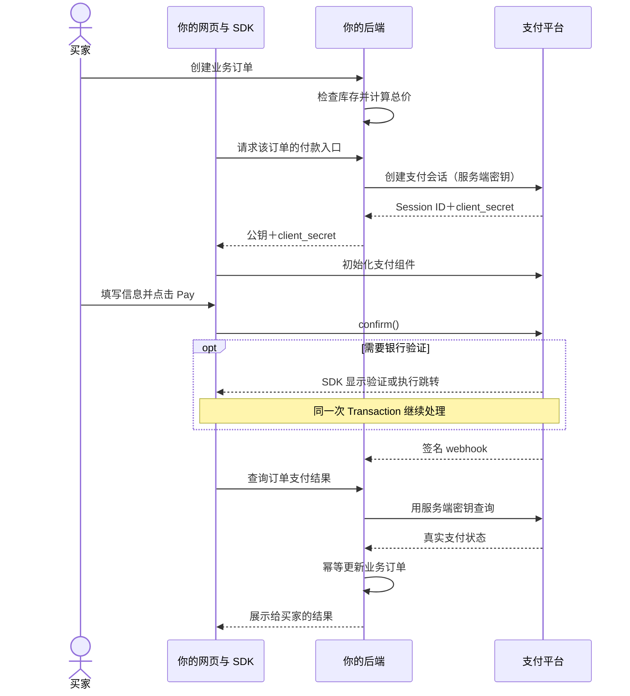
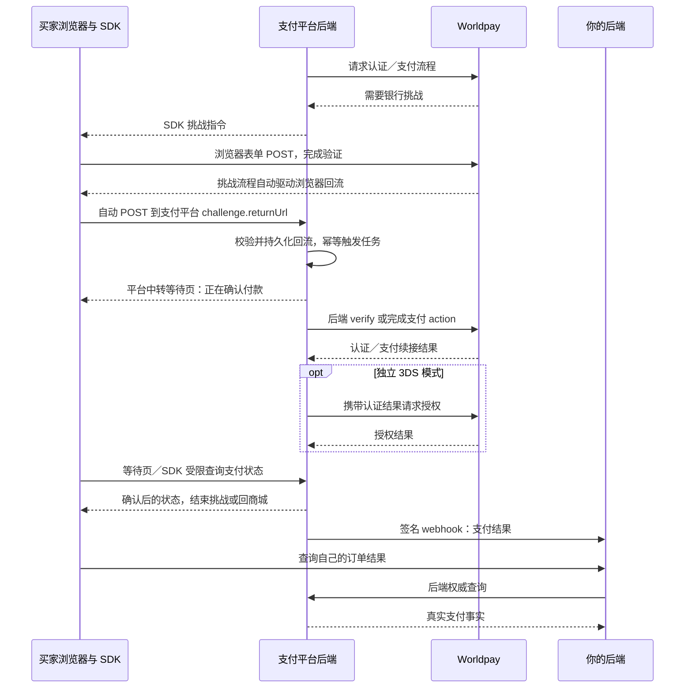

# Payment Element 商户接入指南

面向：需要在网站上接入收款的商户开发者。  
修订日期：2026-10-14。状态：拟定接口的接入说明，尚非可调用的正式 API。包名、域名、响应字段和错误码为设计示例；发布时以正式契约为准。

你需要具备 HTTP、JavaScript／React 和前后端分工的基本知识。本文从创建订单开始说明完整接入，不要求你阅读平台内部设计。

## 1. 你要做什么

你可以选择整页托管、完整支付组件或独立安全字段；三种共用后端 Session 与支付结果处理。接入分为四项工作：

| 工作 | 位置 | 目的 |
| --- | --- | --- |
| 创建支付会话 | 你的后端 | 使用真实订单金额，为买家准备付款入口 |
| 打开支付页或挂载与确认付款 | 你的结账页／平台托管页 | 按选择的方案展示 UI，平台处理支付和银行验证 |
| 提供结果查询与返回页 | 你的前后端 | 买家跳回、刷新或网络异常时显示真实结果 |
| 接收 webhook | 你的后端 | 页面关闭后仍能收到支付状态，更新订单 |

你继续使用自己的订单系统和买家登录／游客结账机制。买家无需登录支付平台，你也无需编写银行验证或支付平台 token 刷新代码。

### 1.1 一笔订单与一次付款尝试

- **你的业务订单**：你的网站保存的购物订单，包括商品、库存、金额和买家。
- **支付会话（Checkout Session）**：平台为某个订单版本创建的付款入口，固定金额、币种和支付配置。
- **支付交易（Transaction）**：买家的一次付款尝试。明确失败后的再次尝试是新的 Transaction；银行验证仍属于原 Transaction。

平台还会在内部维护支付 Order。**创建会话时平台自动创建或关联它，你无需先调用另外的创建订单接口。** 你只需提供稳定的业务订单号与版本。

### 1.2 完整流程（B／C；A 的前端由平台页执行）



Webhook 和查询可以任意先后到达。浏览器跳转或关闭后，SDK 的函数调用可能不会返回，后端仍必须能够处理结果。

### 1.3 选择你的接入方案

| 方案 | 你在前端做什么 | 谁负责 Pay 按钮 | 哪些内容可定制 |
| --- | --- | --- | --- |
| A. Hosted Payment Page | 打开平台返回的支付页 URL，无需支付 SDK | 平台 | 支持的品牌颜色、logo、语言 |
| B. Payment Element | 将一个完整支付组件挂载到你的页面 | 你负责普通 Pay；组件负责方式专用按钮 | 支付区域布局和受限主题；周边页面由你设计 |
| C. Hosted Fields | 分别指定卡号、有效期、CVV 字段容器 | 你 | 字段排列、周边标签、错误位置和受限输入样式 |

A 最少前端代码；B 保留商城结账体验并预留多支付方式；首期按已发布能力矩阵开放；C 适合深度定制卡表单，首期仅卡支付。三种都是拟定产品方案，以下先讲共享后端，再分别给接入代码。

一个 Payment Element 不代表只有一个 iframe。B 对你是一个组件，内部可包含多个安全字段 frame；C 是多个字段容器，各由 SDK 挂载安全 iframe。你不需要自己创建或访问这些 frame。

## 2. 接入前准备：凭证与地址

### 2.1 三种凭证

| 凭证 | 在哪里使用 | 用途 |
| --- | --- | --- |
| 公钥 `pk_test_...`／`pk_live_...` | 浏览器，可写入前端配置 | 公开商户标识，用来加载对应配置；不能授权付款 |
| 服务端私密钥 `sk_test_...`／`sk_live_...` | 仅你的后端 | 创建会话、查询支付、请款、取消和退款，操作受账户权限限制 |
| webhook 签名密钥 | 仅你的后端 | 验证收到的事件是否由平台发送 |

B／C 创建会话还会返回 **`client_secret`**。这是该会话的敏感访问凭证，只发给有权支付这笔订单的买家，再交给 SDK。它不是公开值，也不是你的服务端密钥。不要放入 URL、浏览器持久化存储、日志、埋点、错误上报或截图。

A 返回 `checkout_url`，商户前端无需公钥、client_secret 或支付 SDK，但服务端仍使用私密钥和独立 webhook 密钥。

测试与正式环境使用配套公钥、私密钥、会话和 webhook 配置，不能混用。本文以直接商户的私密钥接入为例；代表多个商户操作的平台／插件使用商户 OAuth 授权，不能向商户索取无限制密钥。

### 2.2 登记地址

接入前在平台登记：B／C 的商户结账页 origin、三种模式共同的买家返回 URL 和后端 webhook 地址。它们用途不同：

| 地址 | 谁访问 | 什么时候访问 |
| --- | --- | --- |
| 结账页，例如 `https://shop.example/checkout` | 买家 | 填写支付信息 |
| 返回页，例如 `https://shop.example/payments/return` | 买家浏览器／银行验证回流 | 跳转付款后回来 |
| webhook，例如 `https://shop.example/api/walletpay-webhook` | 平台服务器 | 通知支付状态 |

`return_url` 不是支付提交地址，也不是 webhook 地址。SDK 直接向平台的支付域提交确认请求；你不需要代理卡数据或 confirm 请求。

按正式接入配置设置页面 CSP、frame 和 connect 权限。具体域名与支付方式要求以发布清单为准，不使用放开所有来源的通配配置。

## 3. 第一步：创建业务订单与支付会话

### 3.1 先在你的后端创建订单

你的后端确认商品、库存、买家或游客身份，并计算总价。浏览器可以提交商品选择或订单引用，**支付金额必须从后端订单取得**。

订单需要稳定引用 `merchant_order_reference` 和版本 `order_version`。购物车变化时保留订单引用、增加版本；仅因付款失败或会话过期，不必修改订单版本。

### 3.2 用服务端密钥创建会话

```http
POST /v1/checkout-sessions
Authorization: Bearer sk_test_example
Idempotency-Key: checkout_ORDER-100123_v1_g1
Content-Type: application/json
```

```json
{
  "merchant_order_reference": "ORDER-100123",
  "order_version": 1,
  "ui_mode": "embedded",
  "amount": { "value": 1099, "currency": "USD" },
  "capture_mode": "automatic",
  "return_url": "https://shop.example/payments/return",
  "locale": "zh-CN",
  "navigation_policy": "allow_redirect",
  "expires_in_seconds": 1800
}
```

| 参数 | 说明 |
| --- | --- |
| `merchant_order_reference` | 你的稳定业务订单号；用于关联和对账 |
| `order_version` | 订单版本；金额或购物车变化时增加 |
| `ui_mode` | `hosted`、`embedded` 或 `fields`；省略默认 embedded，创建后不可变 |
| `amount.value` | 货币最小单位金额；USD 的 `1099` 表示 10.99 美元 |
| `amount.currency` | 三位币种代码，如 USD、HKD、JPY |
| `capture_mode` | `automatic` 自动授权并请款；`manual` 仅先授权 |
| `return_url` | 已登记的买家返回地址，由 SDK 自动使用 |
| `locale` | 可选，组件语言 |
| `navigation_policy` | allow_redirect（默认）或 stay_on_page；后者不绕过必要认证，Hosted 只支持前者 |
| `expires_in_seconds` | 可选，新付款入口的有效期；示例为 30 分钟，正式范围待发布 |

支付授权表示银行批准并保留金额；请款表示向通道确认收取金额；结算是后续资金进入你的可提现余额。三者不是同一时点。默认示例使用自动请款，手工模式的后续操作见 §8。

下面是 B／C 的拟定创建响应，A 的 URL 用法见 §4.1：

```json
{
  "id": "cs_example",
  "order_id": "ord_example",
  "ui_mode": "embedded",
  "client_secret": "cs_example_secret_example",
  "expires_at": "2026-10-14T00:00:00Z",
  "session_status": "open",
  "transaction_id": null
}
```

创建 Session **不新建 Transaction**；若同 Order 的旧 Session 已有交易，其支付限制仍然生效。`order_id` 是平台内部支付订单引用，不替代你的购物订单。

### 3.3 三种方案共享的后端集成示例

下面使用拟定 Node SDK。业务辅助函数由你的应用实现；示例展示接线方式，不是可直接运行的完整服务器。

```ts
import { WalletPay } from "@walletpay/node";

const walletpay = new WalletPay(process.env.WALLETPAY_SECRET_KEY!);

app.post("/api/checkout", async (req, res) => {
  await verifyBuyerCsrf(req);
  const buyer = await authenticateBuyerOrGuest(req);
  const uiMode = await validateAllowedCheckoutMode(buyer, req.body.uiMode ?? "embedded");
  // 浏览器只提供引用；函数校验归属，读取后端权威金额与版本。
  const order = await loadOwnedPayableOrder(buyer, req.body.orderReference);

  // 后端持久化并原子认领创建代次，网络重试复用同一代次／幂等键。
  if (req.body.replaceSessionId) {
    const old = await loadOwnedCheckoutBinding(buyer, req.body.replaceSessionId);
    if (!old || old.orderReference !== order.reference) return res.status(404).end();
    // 查询 Order 汇总并确认旧入口停止新提交；未决／授权未结束则不开放新付款。
    await reconcileAndStopCheckoutEntry(old, order);
  }
  const generation = await claimCheckoutGeneration(order, uiMode);
  const session = await walletpay.checkoutSessions.create(
    {
      merchant_order_reference: order.reference,
      order_version: order.version,
      ui_mode: uiMode,
      amount: { value: order.totalMinor, currency: order.currency },
      capture_mode: "automatic",
      return_url: "https://shop.example/payments/return",
      locale: "zh-CN",
      navigation_policy: "allow_redirect",
      expires_in_seconds: 1800,
    },
    {
      idempotencyKey:
        `checkout_${order.reference}_v${order.version}_g${generation}`,
    },
  );

  await saveCheckoutReference(order, generation, session.id, session.order_id);
  res.set("Cache-Control", "no-store");
  if (uiMode === "hosted") {
    return res.json({ sessionId: session.id, checkoutUrl: session.checkout_url });
  }
  res.json({
    sessionId: session.id,
    publicKey: process.env.WALLETPAY_PUBLIC_KEY,
    clientSecret: session.client_secret,
  });
});
```

调用你自己的接口仍使用你自己的买家／游客鉴权和相应 CSRF 防护。私密钥永远不下发给浏览器。

### 3.4 什么时候复用，什么时候重建

| 情况 | 做法 |
| --- | --- |
| 创建请求网络重试 | 同一幂等键、同一 payload；返回原会话 |
| 同一幂等键但金额不同 | 平台拒绝；修正订单版本和创建请求 |
| 明确付款失败，会话仍有效 | 在原会话中重试；新的付款尝试产生新 Transaction |
| 会话过期，订单内容未变 | 后端增加会话创建代次，用新幂等键创建 Session；订单版本不变 |
| 购物车或金额变化 | 后端增加订单版本，创建替换 Session |
| 原付款结果未知或已授权 | 查询／处理原交易，不能通过新 Session 绕过限制再付 |

普通会话查询不会返回 `client_secret`；创建请求在规定保留窗口内的幂等重放会返回原响应。你不能把“相同订单版本永远复用同一键”作为过期会话重建策略。

### 3.5 首期能力与必需数据

三种模式首期共同验收范围是在线一次性卡支付。平台返回 eligible_methods、required_fields 与 capture／导航能力；商户配置只能收紧，不能开启未开通的方法。钱包、保存卡、off-session 和订阅需要后续专门契约。

SDK 默认采集通道要求的姓名／账单地址／email。当前草案版本为 2026-10-14.preview，正式接入时固定 SDK／API 与 webhook 版本。B 在支付区域内采集；C 的示例提供 BillingDetailsElement 或 billingDetails 容器。自有表单使用 checkout.updateBillingDetails(value) 更新受限非卡数据，金额仍由后端快照决定；不要把 PAN／CVC 放入这些字段。

allow_redirect 允许已验证的整页回流；stay_on_page 只使用可在当前页面完成的能力，不能关闭必要 3DS。首期承诺的浏览器版本随 SDK 发布清单，App 内置浏览器／WebView 未通过矩阵验收前不保证支持；必要时用平台恢复入口在系统浏览器继续原付款。

## 4. 第二步：按方案接入前端

本章按 A／B／C 展示 JavaScript 和 React。三种都使用第 3 章的后端创建接口与第 5、6 章的结果处理。共享状态契约、请求与 React 表单在 §7；你可先读选定方案，再查看共享代码。SDK 尚未发布，以下是拟定接线契约。

### 4.1 A：整页托管

后端创建 hosted Session，只下发 sessionId 与 checkoutUrl。平台托管页拥有支付表单和 Pay，商户不需要支付 SDK；浏览器顶层跳转后，最后回到你的登记 return_url。

#### 4.1.1 JavaScript

页面提供 #open-checkout 按钮和 #payment-message。orderReference、csrfToken 由商户初始化。

```javascript
import { requestCheckoutSession } from "./merchant-api.js";

const button = document.querySelector("#open-checkout");
const message = document.querySelector("#payment-message");
const controller = new AbortController();
let locked = false;
let disposed = false;

async function openHosted() {
  if (locked || disposed) return;
  locked = true;
  button.disabled = true;
  try {
    const setup = await requestCheckoutSession(orderReference, "hosted", csrfToken, controller.signal);
    if (!disposed) window.location.assign(setup.checkoutUrl);
  } catch (error) {
    if (!disposed) {
      message.textContent = error.message;
      locked = false;
      button.disabled = false;
    }
  }
}
button.addEventListener("click", openHosted);

export function dispose() {
  disposed = true;
  controller.abort();
  button.removeEventListener("click", openHosted);
}
```

离开路由调用 dispose。此处只创建付款入口，尚未扣款；创建失败重试由后端复用幂等键。checkoutUrl 只能来自自己的受保护后端，按正式配置检查平台目的域，不接受任意用户输入。

#### 4.1.2 React

```jsx
import { useEffect, useRef, useState } from "react";
import { requestCheckoutSession } from "./merchant-api.js";

export function HostedPay({ orderReference, csrfToken }) {
  const lock = useRef(false);
  const pending = useRef(null);
  const [busy, setBusy] = useState(false);
  const [message, setMessage] = useState("");
  useEffect(() => () => pending.current?.abort(), []);

  async function openHosted() {
    if (lock.current) return;
    lock.current = true;
    setBusy(true);
    const controller = new AbortController();
    pending.current = controller;
    try {
      const setup = await requestCheckoutSession(orderReference, "hosted", csrfToken, controller.signal);
      if (!controller.signal.aborted) window.location.assign(setup.checkoutUrl);
    } catch (error) {
      if (!controller.signal.aborted) {
        setMessage(error.message);
        lock.current = false;
        setBusy(false);
      }
    }
  }
  return <>
    <button type="button" disabled={busy} onClick={openHosted}>去付款</button>
    <p aria-live="polite">{message}</p>
  </>;
}
```

订单引用／版本变化时用 key 替换该入口。A 不使用支付 Provider，不需要商户调用 confirm；平台页执行支付与 3DS。

### 4.2 B：完整 Payment Element

后端创建 embedded Session，返回 sessionId、publicKey、clientSecret。组件拥有支付方式与表单，商户拥有普通 Pay 按钮。一个组件内部可以有多个安全 iframe；你不访问 frame DOM。

#### 4.2.1 JavaScript

```html
<section id="checkout-root">
<form>
<p>付款金额：<span data-role="total"></span></p>
<div id="payment-element"></div>

<button type="submit" data-action="pay" disabled>Pay</button>
<button type="button" data-action="refresh" disabled>刷新结果</button>
<button type="button" data-action="resume" disabled>继续当前付款</button>
<button type="button" data-action="replace-session" disabled>重新进入付款</button>
<p data-role="message" aria-live="polite"></p>
</form>
</section>
```
```javascript
import { loadWalletPay } from "@walletpay/checkout-js";
 import { requestCheckoutSession } from "./merchant-api.js";
 import { bindCheckout } from "./bind-checkout.js";

 export async function mountCheckout({ root, orderReference, csrfToken,
   onReplaceSession, signal }) {
   const setup = await requestCheckoutSession(orderReference, "embedded", csrfToken, signal);
   const walletPay = await loadWalletPay({ publicKey: setup.publicKey });
   if (signal?.aborted) return () => {};
   const checkout = await walletPay.createCheckout({ clientSecret: setup.clientSecret });
   if (signal?.aborted) { checkout.destroy(); return () => {}; }
   const surface = checkout.createPaymentElement({
     layout: "accordion", appearance: { theme: "light" },
   });
   const dispose = bindCheckout({ checkout, root,
     onReplaceSession: () => onReplaceSession(setup.sessionId) });
   surface.mount(root.querySelector("#payment-element"));
   signal?.addEventListener("abort", dispose, { once: true });
   return () => { signal?.removeEventListener("abort", dispose); dispose(); };
 }
```

#### 4.2.2 React

setup 由商户后端返回。进入付款时用 requestCheckoutSession(orderReference, "embedded", csrfToken) 获取它，传入组件；不在 render 时创建 Session 或调用 confirm。

```jsx
import {
  WalletPayProvider, CheckoutProvider, PaymentElement,
} from "@walletpay/react";
import { CheckoutForm } from "./CheckoutForm.jsx";

export function EmbeddedPay({ setup, onReplaceSession }) {
  return <WalletPayProvider key={setup.publicKey} publicKey={setup.publicKey}>
    <CheckoutProvider key={setup.sessionId} clientSecret={setup.clientSecret}>
      <CheckoutForm key={setup.sessionId} sessionId={setup.sessionId}
        onReplaceSession={onReplaceSession}>
        <PaymentElement options={{
          layout: "accordion", appearance: { theme: "light" },
        }} />
      </CheckoutForm>
    </CheckoutProvider>
  </WalletPayProvider>;
}
```

Provider／Element 自动创建、挂载与销毁 JS 核心。Session ID 或公钥变化时 key 触发旧上下文销毁与替换，避免把旧交易 UI 混入新订单。

### 4.3 C：独立 Hosted Fields

后端创建 fields Session，返回与 B 相同的接入参数。你排列三字段容器，SDK 统一管理安全输入和采集；confirm 仍针对整个字段组，不是三个付款。

#### 4.3.1 JavaScript

```html
<section id="checkout-root">
<form>
<p>付款金额：<span data-role="total"></span></p>
<div>卡号</div><div id="card-number"></div>
<div>有效期</div><div id="card-expiry"></div>
<div>安全码</div><div id="card-cvc"></div>
<div id="billing-details"></div>

<button type="submit" data-action="pay" disabled>Pay</button>
<button type="button" data-action="refresh" disabled>刷新结果</button>
<button type="button" data-action="resume" disabled>继续当前付款</button>
<button type="button" data-action="replace-session" disabled>重新进入付款</button>
<p data-role="message" aria-live="polite"></p>
</form>
</section>
```
```javascript
import { loadWalletPay } from "@walletpay/checkout-js";
 import { requestCheckoutSession } from "./merchant-api.js";
 import { bindCheckout } from "./bind-checkout.js";

 export async function mountCheckout({ root, orderReference, csrfToken,
   onReplaceSession, signal }) {
   const setup = await requestCheckoutSession(orderReference, "fields", csrfToken, signal);
   const walletPay = await loadWalletPay({ publicKey: setup.publicKey });
   if (signal?.aborted) return () => {};
   const checkout = await walletPay.createCheckout({ clientSecret: setup.clientSecret });
   if (signal?.aborted) { checkout.destroy(); return () => {}; }
   const surface = checkout.createCardFields({
     appearance: { theme: "light" },
     accessibility: { labels: { number: "卡号", expiry: "有效期", cvc: "安全码" } },
   });
   const dispose = bindCheckout({ checkout, root,
     onReplaceSession: () => onReplaceSession(setup.sessionId) });
   surface.mount({ number: root.querySelector("#card-number"),
     expiry: root.querySelector("#card-expiry"), cvc: root.querySelector("#card-cvc"),
     billingDetails: root.querySelector("#billing-details") });
   signal?.addEventListener("abort", dispose, { once: true });
   return () => { signal?.removeEventListener("abort", dispose); dispose(); };
 }
```

#### 4.3.2 React

setup 对应 fields Session。CardFields 是统一卡字段组；BillingDetailsElement 收集另行要求的姓名／账单数据。缺少或重复必需字段是配置错误，全部必要数据有效才 canConfirm。

```jsx
import {
  WalletPayProvider, CheckoutProvider, CardFields,
  CardNumberField, CardExpiryField, CardCvcField, BillingDetailsElement,
} from "@walletpay/react";
import { CheckoutForm } from "./CheckoutForm.jsx";

export function CustomCardPay({ setup, onReplaceSession }) {
  return <WalletPayProvider key={setup.publicKey} publicKey={setup.publicKey}>
    <CheckoutProvider key={setup.sessionId} clientSecret={setup.clientSecret}>
      <CheckoutForm key={setup.sessionId} sessionId={setup.sessionId}
        onReplaceSession={onReplaceSession}>
        <CardFields options={{ appearance: { theme: "light" } }}>
          <div className="field-label">卡号</div>
          <CardNumberField ariaLabel="卡号" />
          <div className="card-row">
            <div>
              <div className="field-label">有效期</div>
              <CardExpiryField ariaLabel="有效期" />
            </div>
            <div>
              <div className="field-label">安全码</div>
              <CardCvcField ariaLabel="安全码" />
            </div>
          </div>
        </CardFields>
        <BillingDetailsElement />
      </CheckoutForm>
    </CheckoutProvider>
  </WalletPayProvider>;
}
```

商户 JSX 只排列挂载点，不接收原始卡值。CardFields 绑定连接到同一个 JS 字段组，将状态统一投影到 useCheckout；一次 confirm 采集整个组并编排 3DS。

### 4.4 银行验证：前端交互，后端确认

3DS 是银行验证持卡人的步骤，认证通过后付款仍可能被拒绝。你仍调用同一个 `confirm()`，无需直接接 Worldpay，也无需获取其后台凭证。

以 Access Worldpay Web 接口为例，它不是纯前端或纯后端流程：

| 环节 | 谁执行 | 你的商户代码需要做什么 |
| --- | --- | --- |
| 初始化设备采集与请求认证 | 支付平台后端调用 Worldpay | 无专属代码 |
| 浏览器设备采集与银行挑战 | 平台 SDK、受控 iframe、银行页面 | 保持支付组件挂载，显示验证提示 |
| 挑战完成回流 | Worldpay／银行挑战流程自动驱动浏览器 POST 到支付平台后端 | 无需发起或接收该表单 |
| 查证认证结果并继续付款 | 支付平台后端调用 Worldpay | 不把验证完成当付款成功 |
| 展示支付结果 | SDK 返回或通过你的订单结果接口 | 显示处理中／成功／失败 |
| 更新订单与履约 | 你的后端处理签名 webhook 或认证查询 | 与 §5、§6 共用幂等处理 |

#### 挑战 URL 怎样流转

Worldpay 将 challenge URL 和 JWT 返回给支付平台后端。SDK 加载支付平台的受控页面，该页面在浏览器里用表单 POST 启动银行挑战。

你不需要把 challenge URL 放进 iframe，也不应直接导航到它。它是 POST 目标，不是简单的 iframe GET 地址。原始 JWT 和认证值不交给你的业务代码；它们在平台控制的浏览器页面或后端之间使用。[W1]

#### 两个返回地址不要混淆

| 地址 | 谁管理 | 用途 |
| --- | --- | --- |
| Worldpay `challenge.returnUrl` | 支付平台后端设置和接收 | 挑战流程自动驱动浏览器 POST 回支付平台，触发后端查证 |
| 你创建 Session 时的 `return_url` | 你的后端 | SDK 整页交互结束后带买家回商城，由你的后端查询订单结果 |

内嵌验证结束通常仍留在你的结账页，不需要整页跳回。整页／银行 App 模式下原页面可能销毁，`confirm()` Promise 不保证返回，结果仍用 §5 和 §6 恢复。

#### 谁负责 POST，商户是否需要写代码

**不需要。`challenge.returnUrl` 是支付平台自己的后端 URL，你无需配置它，也无需在前端 POST 到它。** 你只配置创建 Session 时的商城 `return_url`。

这里有两次不同的表单提交：

1. **启动挑战**：支付平台 SDK／托管页面在买家浏览器中提交 JWT 表单，打开银行验证界面。这部分由支付平台实现。
2. **挑战结束回流**：Worldpay／银行挑战流程自动驱动买家浏览器，向平台预先设置的 `challenge.returnUrl` POST。商户不实现这次提交，SDK 也不需要手工模拟它。[W1]

支付平台后端接收回流，查证认证结果并继续付款；平台提供的回流页面脚本通知 SDK 恢复界面，SDK 查询支付状态。SDK 自动管理交互与恢复；你只需按 §5、§6 查询订单结果和接收平台签名 webhook。

#### 平台中转等待页与返回商城

平台将 `challenge.returnUrl` 设为自己的后端入口。接收浏览器 POST 后，平台校验并保存关联，返回平台托管的“正在确认付款”页面，同时由后端查证认证并继续原 Transaction 的支付。该页面和查询逻辑由平台／SDK 提供，你无需另写中转页。Worldpay 允许接收端后端发起 verification，并在 iframe 内显示页面；本平台据此提供中转等待体验。[W1]

**验证通过后，平台仍需确认授权／请款结果。** 等待页不会仅因 verify 成功就宣布付款成功，也不会要求你再次调用 confirm。后端处理不依赖等待页持续打开；若界面等待超过阈值，可以返回商城“处理中”页，由你的后端继续查询和接收 webhook。等待超时不表示支付失败。

| 交互方式 | 等待完成后买家去哪里 |
| --- | --- |
| 整页托管／整页跳转 | 平台控制顶层页面时，带买家到你创建 Session 时设置的 `return_url`；你的结果页查询自己的后端 |
| 内嵌挑战 iframe | 平台等待页通知 SDK，SDK 关闭挑战层并更新原结账页；通常无需整页跳转 |
| 弹窗挑战 | 平台通知原页 SDK，确认后关闭弹窗；原页不可用时提供安全的返回商城操作 |

iframe 内直接跳转不会自动让整个商城页面跳转。若需要整页回流，由 SDK 按导航契约协调父页执行。返回商城可能显示成功、失败或处理中；返回 URL 和浏览器通知均不作为更新订单、发货或再次付款的依据。

“自动回流”要求浏览器正常完成挑战；在回流前关页可能导致平台尚未收到该请求。因此不能把自动回流理解成必达的后台通知。

如果阅读 Worldpay 官方文档看到“your backend”，它指直接接入 Worldpay 的一方。在本接入方案里是支付平台，不是你的商城后端。

#### 支付平台如何知道验证结果

挑战完成的浏览器 POST 只提供关联信息，不是付款成功证据。平台后端再调用 Worldpay 的 verification，取得认证结果，然后请求支付授权；若采用 Integrated 3DS，平台后端调用原支付的完成 action 继续流程。两种模式都不会要求你的浏览器直接调用 Worldpay 后台 API。[W1][W2]



这里 Worldpay 汇总其浏览器服务和后台 API；浏览器和后端的职责已在每条调用中标明。Webhook 是支付平台主动发送给你的后端，与浏览器挑战回流是两条不同的信息流。

#### 事件、关页与过期

- `actionstart` 表示开始银行交互，`actionend` 表示交互结束；两者都不能授权发货。
- 关闭验证框或浏览器后，先查订单状态，不直接报告付款失败，也不引导再付一次。
- Session 过期不取消已经开始的 Transaction；SDK 管理本平台续接，但不能延长银行／通道挑战的期限。
- 浏览器回流已经到达平台后端后，后续查证可以后台继续；若在回流前关页，则可能仍未完成，不能承诺一定继续付款成功。
- 显示“处理中”时等待后端结果；若 SDK 要求恢复交互，按其明确指令操作，不新建第二笔未决付款。

以上是 SDK 的内部实现说明。商户只实现标准接入、订单结果接口和 webhook，不接触 Worldpay challenge 表单、verify 或 complete3dsChallenge 接口。

### 4.5 实例与重建

`requestCheckoutSession` 是你自己请求后端的辅助函数；SDK 的 createCheckout 只绑定已有 Session。普通 render、重新挂载和创建字段都不新建平台交易。

onReplaceSession 是父页面提供的回调：携带原 Session 引用调用你自己的后端，后端查证并停止旧入口、认领新创建代次，再由父页面销毁旧上下文并传入新 setup。未知结果不直接换入口再扣款；新确认仍受平台 Order 级限制。

JS 调用 mountCheckout 时传入路由 AbortSignal；异步初始化晚到时不挂回旧路由。React 按 Session ID／公钥替换 Provider，绑定自动清理所属字段；SDK 恢复控制器由 Provider 管理，商户仅订阅状态与绑定按钮。

unmount 只移除输入呈现并清空敏感输入，允许有效实例重挂并重新 ready；destroy 幂等销毁整个实例，不可重挂。二者都不取消后台支付。

## 5. 第三步：结果查询与返回页

### 5.1 返回地址只提供查询引用

```text
https://shop.example/payments/return?checkout_session=cs_example
```

引用说明“查哪一笔”，不说明是否成功，也不证明访问者身份。不要相信 URL 中自造的 `success=true` 或金额。

返回页和原结账页都可以调用同一个商户结果接口。游客也必须通过你自己的受保护结账会话校验；银行 App 返回后身份丢失，应先恢复买家身份，不能只凭 Session ID 展示订单。

### 5.2 后端结果接口：查整个订单，不只查当前会话

先用已保存的 Session 绑定检查买家／游客归属，再调用平台查询。平台会话查询需要包含 Order 级 order_payment 汇总：即使本 Session 没有交易，旧 Session 的在途付款也可能仍然存在。

```javascript
app.get("/api/checkout/result", async (req, res) => {
  const buyer = await authenticateBuyerOrGuest(req);
  const binding = await loadOwnedCheckoutBinding(buyer, req.query.session);
  if (!binding) return res.status(404).end();
  const session = await walletpay.checkoutSessions.retrieve(binding.sessionId);
  await validatePlatformBinding(binding, session);
  // 使用 Order 汇总，验证相关交易的实际订单版本和金额。
  await applyVerifiedOrderPayment(binding, session.order_payment);
  const status = await buildBuyerOrderResult(binding, session);
  res.set("Cache-Control", "no-store");
  res.json(status);
});
```

辅助函数由商户实现。buildBuyerOrderResult 仅投影已验证的支付事实、实际版本金额和自己的履约状态，不计算 SDK 的付款资格。旧版本付款不能自动满足新版本。不存在与无权访问均用相同 404。

### 5.3 返回页示例

```ts
const sessionId = new URLSearchParams(location.search).get("checkout_session");
if (!sessionId) {
  showMissingCheckoutReference();
} else {
  const response = await fetch(
    `/api/checkout/result?session=${encodeURIComponent(sessionId)}`,
    { credentials: "include", cache: "no-store" },
  );
  if (!response.ok) showResultAccessError(response.status);
  else renderOrderResult(await response.json());
}
```

接口未决时显示“处理中”，有限轮询或引导查看订单。无论等待多久，浏览器超时都不等于付款失败。

结果接口返回 BuyerOrderResult：paymentStatus、transactionId、paidOrderVersion、paidAmount、capture、orderVersionMatches 和 fulfillmentStatus。paidOrderVersion／paidAmount 仅在已有授权／请款事实时存在；不匹配当前业务版本时由商户处理履约异常，不自动当成已付新订单。该结果用于订单展示，不含由商户推断的支付资格；结账按钮与恢复操作使用 SDK 状态。

## 6. 第四步：接收 webhook

### 6.1 Webhook 是后台通知

买家可能付完就关闭页面，因此必须接收平台发送到后端的事件。投递会重试，可能重复或乱序。Webhook 是主要异步通知路径；你仍需要查询和对账补偿，不能假设网络和端点永远可用。

处理顺序：**验签 → 持久化事件 → 应答 → 后台幂等处理**。

### 6.2 验签与持久化示例

正式发布使用平台 Node SDK 的验签函数；下列仍为拟定接口。验签基于原始 body，支持签名密钥轮换、时间容差和事件 schema，不要求你自行解析 HMAC。

```ts
import express from "express";
// 在全局 JSON parser 之前注册；应用已初始化 walletpay。
app.post("/api/walletpay-webhook",
  express.raw({ type: "application/json", limit: "1mb" }),
  async (req, res) => {
    let event;
    try {
      event = walletpay.webhooks.constructEvent(req.body, req.headers,
        webhookSigningSecrets, { toleranceSeconds: 300 });
    } catch { return res.status(400).end(); }
    await validateEventAccountAndEnvironment(event);
    await inbox.persistIfNew(event.id, event); // 事务落库失败则非 2xx。
    res.status(200).end();
  },
);
```

webhookSigningSecrets 从服务端配置读取当前和轮换中的端点密钥，不能放前端。SDK 只验证事件真实性；端点配置归属、业务订单与履约仍由你的后端检查。

### 6.3 后台订单处理

字段校验失败、组件加载失败或按钮点击不是支付事件；只有平台持久化的交易状态变化才进入支付 webhook。

Worker 从持久 inbox 读取事件，验证订单关联与支付事实，调用与查询共用的 `applyVerifiedPaymentToOrder`，成功后标记处理完成；失败保留待重试。实现应具有崩溃恢复能力，不能只在 HTTP 应答后临时执行一个函数。

两层去重都需要：事件 ID 防止重复消费同一事件；订单更新和履约效果的唯一约束防止不同事件、查询与 webhook 同时触发重复发货。

乱序事件不能把已请款订单覆盖成处理中。失败事件要对应具体 Transaction，不能因旧失败尝试的迟到通知把已成功订单标为失败。事件 v1 使用 2026-10-14.preview 草案语义，正式发布前固定 schema 和版本；商户应用以权威状态和允许转换为准。

### 6.4 投递、版本与排障

首期事件包括 transaction.updated、authorization.updated、capture.updated、refund.updated 和 Session 入口变化事件。信封包含 id、type、api_version、created_at、livemode、merchant_id 和 data；data 包含资源 ID、实际版本金额与资源修订。入口变化不等于付款失败，原始卡数据、secret 和认证值不进入事件。

自动投递采用有界退避，最多 72 小时；失败进入平台告警与待处理队列。保留的 30 天投递窗口内可请求人工重发，之后通过资源查询／对账恢复。重发保留 event.id 和 body，刷新投递时间戳与签名。不要依赖投递顺序或创建时间排序，修订不明时查询原资源。

服务端错误与 SDK 错误带 Request-Id／requestId，可交给平台支持排障，不提交 secret 或原始回调。固定 API 和 webhook 版本，先在测试环境验证升级；字段或事件新增时保守记录与查询。查询、重发和资源支持入口是上线必需，自助投递面板可后续完善。

## 7. SDK 状态、结果与共享接线

**默认商户不再复制支付恢复状态机。** 平台计算付款执行资格；SDK 管理提交关联、原键重放、受限轮询、Action 续接、金额快照和迟到响应隔离。商户只订阅规范化 UI 状态并调用 confirm／refresh／resume，后端继续负责业务订单与履约。

### 7.1 状态与公开方法

以下是本平台拟定 v1 契约，不表示与 Stripe API 同名兼容。createCheckout 的 Promise 表示绑定与 bootstrap 完成；type=ready 只表示可以呈现会话，字段仍可能正在挂载。只有 canConfirm 才表示此刻可发起新的确认。

```ts
type PaymentStatus = "unpaid" | "processing" | "authorized" | "captured" | "failed";
type BlockingReason = "fields_incomplete" | "request_in_progress" | "action_required"
  | "payment_pending" | "outcome_unknown" | "already_authorized" | "already_captured"
  | "session_expired" | "session_replaced" | "order_changed" | "configuration_error"
  | "network_unavailable";
type ErrorCode = "invalid_input" | "configuration_error" | "unsupported_method"
  | "authentication_failed" | "payment_declined" | "action_canceled"
  | "popup_blocked" | "network_unavailable" | "outcome_unknown"
  | "session_expired" | "session_replaced" | "snapshot_mismatch"
  | "idempotency_conflict" | "request_in_progress" | "internal_error";
type PaymentError = {
  code: ErrorCode; category: "integration" | "buyer" | "payment" | "network";
  message: string; // 平台本地化且可安全展示，不含通道原始错误或秘密。
  field?: "number" | "expiry" | "cvc" | "billingDetails";
  requestId?: string;
};
type CheckoutReadyState = {
  type: "ready";
  snapshot: { id: string; orderVersion: number;
    amount: { value: number; currency: string }; displayAmount: string };
  payment: { status: PaymentStatus; transactionId?: string;
    capture?: "manual" | "pending" | "failed" };
  sessionStatus: "open" | "expired" | "replaced" | "completed";
  canConfirm: boolean; blockingReason?: BlockingReason;
  canRefresh: boolean; canResume: boolean; canReplaceSession: boolean;
  message: string; error?: PaymentError;
};
type CheckoutState = { type: "loading" }
  | { type: "error"; error: PaymentError } | CheckoutReadyState;
type ConfirmResult = { type: "result"; state: CheckoutReadyState }
  | { type: "error"; error: PaymentError };
type CheckoutHook = { type: "loading" }
  | { type: "error"; error: PaymentError }
  | { type: "ready"; checkout: Checkout; state: CheckoutReadyState };
```

canConfirm 合并：字段完整、当前快照有效、Session 可提交、平台 Order 资格、没有本实例并行操作或待处理 Action。它是 UI 提示，不是支付权限；服务端每次重新验证。商户可因库存／条款等业务条件进一步禁用按钮，但不能自行把平台拒绝变成允许。

查询失败时 SDK 关闭新的确认，显示 network_unavailable；不会把查询失败写成支付 failed。bootstrap 配置错误进入 type=error；字段／付款错误放在 ready.error，SDK 根据最新证据重新计算 canConfirm。

同实例 resume 恢复尚未受理的 prepared 提交时，可在买家手势下首次受理并创建其唯一 Transaction；已有 Transaction 时只续接它。

canResume 只指向已关联的原提交／Action；canReplaceSession 表示当前可请求替换入口，不保证替换后可付款。authorized 或 captured 时禁止新 confirm；请款失败仍保留授权。SDK 将未知扩展错误码保守映射为 internal_error，保留 requestId，不因未知枚举放开按钮。

| 方法／事件 | 契约 |
| --- | --- |
| getState() | 同步返回最新不可变状态快照 |
| subscribe(listener) | 订阅即回调当前状态，随后按实例内递增修订发布；返回幂等 unsubscribe |
| confirm({ expectedSnapshotId, billingDetails? }) | 用户手势发起新确认；同步锁住本实例，复用未决逻辑提交，自动处理支持的 Action／短时网络恢复 |
| refresh() | 只查证状态，不创建提交、授权或新 Transaction；重复刷新合并 |
| resume() | 仅在 canResume 时继续已有提交／Action，不生成新的提交键或第二笔 Transaction；交互需用户手势 |
| updateBillingDetails(value) | 只更新受限非卡数据并重新校验 canConfirm，不改变订单金额 |
| actionstart／actionend | 可选的呈现提示，不能驱动业务状态或解除付款限制 |

confirm／refresh／resume 的业务、网络和能力错误以有类型结果返回，并发布到状态，不产生未处理 Promise rejection。程序参数类型错误在开发阶段抛错。destroy 后方法返回 configuration_error；旧请求不向已销毁实例发布状态。整页跳转仍可能让 Promise 不再返回。

**金额显示合同：** SDK 从平台获得 snapshot.id、金额、币种、orderVersion 和本地化 displayAmount。B／C 的摘要与 Pay 附近显示该值，confirm 传入刚展示的 expectedSnapshotId；SDK 和服务端校验其与 Session 一致。它声明商户界面使用的平台快照，不是对浏览器 DOM 或买家真实看到什么的安全证明。实际收款金额始终来自服务端。

订单变化时旧快照标记 order_changed，禁止确认，商户后端创建新版本 Session；普通刷新不修改原 Session 金额。同一页面不能展示新购物车总额却继续确认旧 Session。Hosted 页由平台履行同一显示合同。

自动恢复默认采用有限预算：网络重放最多 3 次、指数退避且遵守 Retry-After；轮询总预算 2 分钟、间隔最大 30 秒，页面不可见时暂停。预算耗尽只停止自动 UI 等待，不改变交易状态；暴露刷新／继续已有操作或订单支持入口。具体时限通过版本化 recovery_policy 下发，服务器可缩短但不能用其解除 Order 约束。

原键恢复能力由 SDK 内部与 resume 统一承担；不另设默认 retryConfirmation API。字段 complete、提交键、unknown 匹配等规则不再要求商户复制。字段级错误仍可通过 Fields 事件自定义展示，不向商户暴露原始卡值。

### 7.2 JavaScript：共享商户请求

requestCheckoutSession 和 replaceCheckoutSession 是商户辅助函数。A 返回 sessionId／checkoutUrl，B／C 返回 sessionId／publicKey／clientSecret；SDK createCheckout 只绑定已有入口。

```javascript
async function postCheckout(payload, csrfToken, signal) {
  const response = await fetch("/api/checkout", {
    method: "POST", credentials: "include", signal,
    headers: { "Content-Type": "application/json", "X-CSRF-Token": csrfToken },
    body: JSON.stringify(payload),
  });
  if (!response.ok) throw new Error("创建付款入口失败");
  return response.json();
}

export function requestCheckoutSession(orderReference, uiMode, csrfToken, signal) {
  return postCheckout({ orderReference, uiMode }, csrfToken, signal);
}

export function replaceCheckoutSession(replaceSessionId, orderReference, uiMode, csrfToken, signal) {
  return postCheckout({ replaceSessionId, orderReference, uiMode }, csrfToken, signal);
}

export async function queryOrderStatus(sessionId, signal) {
  const response = await fetch(
    `/api/checkout/result?session=${encodeURIComponent(sessionId)}`,
    { credentials: "include", cache: "no-store", signal },
  );
  if (!response.ok) throw new Error("暂时无法查询订单");
  return response.json();
}
```

### 7.3 JavaScript：只绑定 SDK 状态与页面

每个 B／C 表单包含 total、message 和 pay／refresh／resume／replace-session 挂载点。先 subscribe，再 mount；SDK 在 bootstrap、挂载和状态变化时重新计算资格。商户代码不实现原交易匹配或付款资格算法。

```javascript
// 商户 DOM 适配器。支付状态机、轮询与恢复由 SDK 实现。
export function bindCheckout({ checkout, root, onReplaceSession }) {
  const form = root.querySelector("form");
  const pay = root.querySelector('[data-action="pay"]');
  const refresh = root.querySelector('[data-action="refresh"]');
  const resume = root.querySelector('[data-action="resume"]');
  const replace = root.querySelector('[data-action="replace-session"]');
  const total = root.querySelector('[data-role="total"]');
  const message = root.querySelector('[data-role="message"]');
  let renderedSnapshotId;
  let disposed = false, replacing = false;

  const unsubscribe = checkout.subscribe((state) => {
    if (disposed) return;
    const ready = state.type === "ready";
    renderedSnapshotId = ready ? state.snapshot.id : undefined;
    total.textContent = ready ? state.snapshot.displayAmount : "";
    pay.disabled = !ready || !state.canConfirm || replacing;
    refresh.disabled = !ready || !state.canRefresh || replacing;
    resume.disabled = !ready || !state.canResume || replacing;
    replace.disabled = !ready || !state.canReplaceSession || replacing;
    message.textContent = ready ? state.message :
      state.type === "error" ? state.error.message : "正在加载付款入口";
  });

  const submit = (event) => {
    event.preventDefault();
    if (!disposed && !replacing && renderedSnapshotId) {
      void checkout.confirm({ expectedSnapshotId: renderedSnapshotId });
    }
  };
  const onRefresh = () => { void checkout.refresh(); };
  const onResume = () => { void checkout.resume(); };
  const onReplace = async () => {
    if (disposed || replacing || !checkout.getState().canReplaceSession) return;
    replacing = true;
    pay.disabled = refresh.disabled = resume.disabled = replace.disabled = true;
    try { await onReplaceSession(); }
    catch {
      if (!disposed) {
        message.textContent = "入口更新失败，请刷新结果后再试";
      }
    } finally {
      replacing = false;
      if (!disposed) await checkout.refresh();
    }
  };
  form.addEventListener("submit", submit);
  refresh.addEventListener("click", onRefresh);
  resume.addEventListener("click", onResume);
  replace.addEventListener("click", onReplace);
  return () => {
    if (disposed) return;
    disposed = true;
    unsubscribe();
    form.removeEventListener("submit", submit);
    refresh.removeEventListener("click", onRefresh);
    resume.removeEventListener("click", onResume);
    replace.removeEventListener("click", onReplace);
    checkout.destroy();
  };
}
```

### 7.4 React：判别联合与声明式状态

useCheckout 在 loading／error 阶段不暴露可用 Checkout；ready 阶段提供 checkout 和 state。ready 不等待子组件字段挂载，避免“先 ready 才渲染字段、先挂字段才 ready”的循环。Provider 管理 SDK 生命周期，普通回调引用更新不重建支付控制器。

```jsx
import { useRef, useState } from "react";
import { useCheckout } from "@walletpay/react";

export function CheckoutForm({ sessionId, onReplaceSession, children }) {
  const result = useCheckout();
  const [replacing, setReplacing] = useState(false);
  const replacementLock = useRef(false);
  const [localMessage, setLocalMessage] = useState("");
  if (result.type === "loading") return <p>正在加载付款入口</p>;
  if (result.type === "error") return <p role="alert">{result.error.message}</p>;
  const { checkout, state } = result;

  async function replaceSession() {
    if (replacementLock.current || !state.canReplaceSession) return;
    replacementLock.current = true;
    setReplacing(true);
    setLocalMessage("");
    try { await onReplaceSession(sessionId); }
    catch { setLocalMessage("入口更新失败，请刷新结果后再试"); }
    finally { replacementLock.current = false; setReplacing(false); }
  }
  return <form onSubmit={(event) => {
    event.preventDefault();
    if (!replacing && state.canConfirm) {
      void checkout.confirm({ expectedSnapshotId: state.snapshot.id });
    }
  }}>
    <p>付款金额：{state.snapshot.displayAmount}</p>
    {children}
    <button type="submit" disabled={replacing || !state.canConfirm}>Pay</button>
    <button type="button" disabled={replacing || !state.canRefresh}
      onClick={() => void checkout.refresh()}>刷新结果</button>
    {state.canResume && <button type="button" disabled={replacing}
      onClick={() => void checkout.resume()}>继续当前付款</button>}
    {state.canReplaceSession && <button type="button" disabled={replacing}
      onClick={() => void replaceSession()}>重新进入付款</button>}
    <p aria-live="polite">{localMessage || state.message}</p>
  </form>;
}
```

父页面用 replaceCheckoutSession 取得新 setup，按 Session ID 替换 Provider；新入口不会自动 confirm。替换请求必须查证 Order 并停止旧入口，不能用新 key 绕过未决支付。

```jsx
import { replaceCheckoutSession } from "./merchant-api.js";
async function onReplaceSession(oldSessionId) {
  const next = await replaceCheckoutSession(oldSessionId, orderReference, uiMode, csrfToken);
  setSetup((current) => current.sessionId === oldSessionId ? next : current);
}
```


### 7.5 页面丢失后的恢复

如果返回页查询发现已有付款等待买家交互，先经自己的后端鉴权并申请平台恢复入口，再让买家点击继续。商户后端只调用平台 recover 管理接口，不推断原提交键或伪造成功。原 Session 已过期也可按平台事实恢复既有 Action，不能开始另一笔付款。

```javascript
app.post("/api/checkout/recover", async (req, res) => {
  await verifyBuyerCsrf(req);
  const buyer = await authenticateBuyerOrGuest(req);
  const binding = await loadOwnedCheckoutBinding(buyer, req.body.sessionId);
  if (!binding) return res.status(404).end();
  const recovery = await walletpay.checkoutSessions.recover(binding.sessionId);
  res.set("Cache-Control", "no-store");
  res.json(recovery); // recovery_url，或 recovery_not_required。
});
```

平台恢复页仅查询／继续原操作，不创建新 Transaction。商户在返回地址继续用订单查询和 webhook 确认支付；无法恢复买家身份时先恢复身份，不只凭 Session ID 显示订单。

## 8. 手工请款、取消和退款

这些操作只由你的后端使用服务端凭证发起，并携带持久幂等键。SDK 和 `client_secret` 无权执行。

| 操作 | 用途 | 注意 |
| --- | --- | --- |
| 请款 | 对已有授权确认收款 | 查询原交易，请款未知时不能另起付款 |
| 取消授权 | 请款前撤销原授权 | 必须确认取消／失效，才可评估重新付款 |
| Void | 在当前平台规则允许的阶段撤销请款 | 与取消授权不是同一动作 |
| 退款 | 对符合条件的已收款交易退款 | 当前设计须已下游结算；累计不能超过原请款金额 |
| 作废 Session | 停止该入口接受新付款 | 不取消已提交的授权或请款 |

对应管理接口拟定为 `/v1/payments/{transactionId}` 下的操作。自动模式通常不需要你调用请款；手工模式的履约时点由你的业务政策决定。Void／退款后是否可对同一订单重新收款，需按正式平台规则处理，不自动开放。

### 8.1 操作资格与授权期限

管理查询返回 allowed_operations、capture_before、capturable_amount 和 refundable_amount。请款前检查期限、金额和是否存在未决操作；授权期限无法确认时平台拒绝新请款并说明原因，不让商户猜测统一天数。部分请款仅在通道能力允许时开放。

请款、取消、void、退款均由后端执行，返回 operation_id 及 pending／succeeded／failed／unknown；取消 succeeded 才可按平台资格评估再付，unknown 仍查证原操作。订单入口过期／SDK destroy 都不是取消授权。

当前退款仍要求下游已结算；未满足时返回 not_settled，并说明可用的 cancel／void 或等待／支持操作。SDK 或接入指南不改变该账务政策。

## 9. 上线前检查

- 后端计算金额；买家／游客只能获取和查看自己的订单。
- 创建会话有稳定的订单引用、版本与持久幂等键；过期重建使用新的创建代次。
- 前端只拿公钥和自己的会话凭证；秘密不进 URL、日志或持久化浏览器存储。
- 按 SDK canConfirm 控制 Pay，显示 snapshot.displayAmount，确认传 expectedSnapshotId；不复制恢复状态机。
- 返回页与原结账页通过后端查询订单；丢失原 SDK 时经后端鉴权申请平台恢复入口。
- Webhook 先验签、再持久化、再应答；worker 能恢复并去重履约。
- 验证重复点击、多标签、旧会话在途、跳转、关页、超时、会话过期和乱序事件。
- 使用正式测试环境和合成测试支付信息；仓库 UI 原型不处理真实支付。

## 10. 接口速查

| 接口／SDK | 调用位置 | 凭证 |
| --- | --- | --- |
| `POST /v1/checkout-sessions` | 你的后端 | `sk_`／商户 OAuth |
| `GET /v1/checkout-sessions/{id}` | 你的后端 | `sk_`／商户 OAuth |
| `GET /v1/payments/{transactionId}` | 你的后端 | `sk_`／商户 OAuth |
| `POST /v1/checkout-sessions/{id}/expire` | 你的后端 | `sk_`／商户 OAuth |
| `loadWalletPay({ publicKey })` | 浏览器 | 公开商户标识 |
| `createCheckout({ clientSecret })` | 浏览器 | 会话凭证 |
| `createPaymentElement()`／`mount()`（B） | 浏览器 | SDK 使用会话配置 |
| `createCardFields()`／`mount()`（C） | 浏览器 | SDK 使用会话配置 |
| 打开 `checkout_url`（A） | 浏览器顶层跳转 | 短期托管启动引用；无需商户前端支付 SDK |
| `checkout.confirm({ expectedSnapshotId })` | 浏览器 | SDK 使用会话快照与能力并管理提交、3DS 和续接 |
| `checkout.resume()`／`refresh()`／`subscribe()` | 浏览器 | 既有操作恢复、只读查询与状态订阅；SDK 管理幂等与资格 |
| `POST /v1/checkout-sessions/{id}/recover` | 你的后端 | 鉴权买家后申请平台恢复页，不创建新付款 |
| 你的订单结果接口 | 浏览器 → 你的后端 | 你的买家／游客会话 |
| 你的 webhook 接收接口 | 平台 → 你的后端 | 独立 webhook 签名 |

本指南重写自 wallet-architecture 的 [原商户指南](https://github.com/1aboveio/wallet-architecture/blob/main/docs/payment-element-merchant-integration-guide.md)，反映 2026-10-14 确认的接入流程。文中辅助函数由商户实现，正式 API 与 SDK 发布后应补充可运行示例。

## 11. 3DS 官方参考

本指南中的平台 SDK 封装是拟定设计，Worldpay 示例用于解释信息流，不增加你的接入步骤。核查日期：2026-10-14。

- [W1：Access Worldpay 3DS Web challenge 与 verification](https://docs.worldpay.com/access/products/3ds/web/challenge-verification)
- [W2：Access Worldpay Payments Integrated 3DS](https://docs.worldpay.com/access/products/payments/enable-features/3ds-authentication/integrated-3ds)

## 12. 三种 UI 方案参考

本平台三种方案共用支付内核，以上名称和契约均为拟定。行业参考包括 [Stripe Payment Element](https://docs.stripe.com/payments/payment-element)、[Stripe Checkout](https://docs.stripe.com/payments/checkout)、[Worldpay Checkout 安全字段](https://docs.worldpay.com/access/products/checkout/web/card-and-cvc)。
